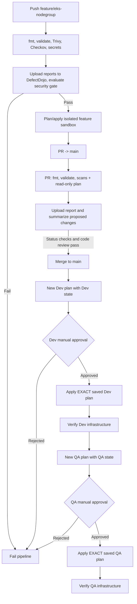
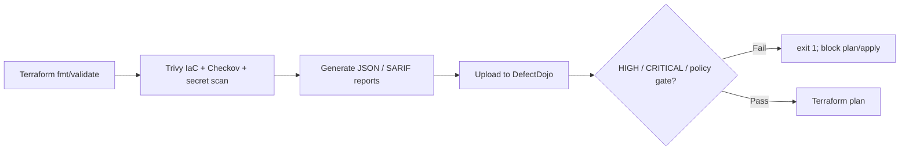
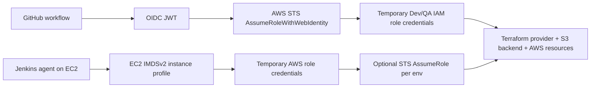

Terraform IaC — GitHub Actions & Jenkins Triggers, Security Gates, Plan/Apply Approvals
> **Purpose:** Beginner-friendly, interview-ready guide to Terraform CI/CD with **feature branch → isolated Dev sandbox**, **PR to main → scans and plan only**, and **merged main → approved Dev plan/apply → approved QA plan/apply**. It covers GitHub Actions and Jenkins, AWS IAM authentication, DefectDojo reporting, remote state safety and failure modes. These are **reference examples**; adjust environment directories and credentials to your real Terraform repository.
1. How Terraform differs from EKS application releases
Application delivery	Terraform infrastructure delivery
Build image from code	Plan infrastructure change from configuration + current state
Reuse same QA image digest in Prod	Do not reuse a Dev plan for QA: each environment has distinct state
Deploy Helm chart	Run `terraform apply` on a reviewed saved plan
Registry holds approved image	Secure artifact storage holds sensitive saved plan
Roll back to older image	Fix config and plan/apply a recovery; state restore only as controlled disaster recovery
The same main Git commit can be deployed to Dev and QA, but each environment must have its own AWS role, state key, variables, infrastructure resources and plan. A PR plan is a preview; a fresh post-merge plan becomes the apply candidate.
2. Branch triggers, approvals and environments

Git event	GitHub Actions trigger/job	Jenkins Multibranch selector	Result	Approval
Push `feature/*`	`on.push.branches` + `if: startsWith(...)`	`branch 'feature/*'` and not PR	Scan, optional isolated sandbox plan/apply	Optional sandbox approval
PR target `main`	`on.pull_request.branches: [main]`	`changeRequest target: 'main'`	Validate, scan, plan only; no apply	PR review + required checks
Merge/push `main`	`on.push.branches: [main]`	`branch 'main'`	Dev plan → Dev approval → apply → QA plan → QA approval → apply	Two independent apply approvals
No Terraform apply in PR context. For untrusted fork PRs, run credential-free validation; a cloud-backed PR plan requires trusted code and a strictly limited AWS plan identity. Running the plan can evaluate provider data sources and modules, so plan is not automatically safe for adversarial code.
3. Example directory and backend layout
```text
terraform/
  modules/eks/               # reusable module(s)
  environments/
    sandbox/                  # example temporary feature environment
    dev/
      main.tf
      backend.tf
      terraform.tfvars
    qa/
      main.tf
      backend.tf
      terraform.tfvars
.github/workflows/
  terraform.yml
Jenkinsfile
```
> These paths are illustrative; map them to the actual repository. Feature sandboxes **must not** share the Dev state key or resource names with other branches.
Example state separation:
```text
s3://my-tf-state/eks/dev/terraform.tfstate
s3://my-tf-state/eks/qa/terraform.tfstate
s3://my-tf-state/eks/sandbox/feature-abc-123/terraform.tfstate
```
Use versioning, encryption, tight bucket/KMS permissions, S3 backend locking supported by your Terraform version, and separate state access policies. Never commit `.terraform/`, `.tfstate`, `.tfplan`, secrets or provider credentials. Ensure only one active plan-review-apply sequence per environment; backend locks alone do not protect the time spent waiting for approval.
4. Security scanning and DefectDojo: report before fail

Generate reports even if there are findings, upload to DefectDojo, then fail the pipeline for policy violations. Keep tool failures distinct from vulnerability findings, and fail closed on malformed/missing results or failed mandatory report upload. SonarQube can check scripts/code if present, but Checkov and Trivy config are more directly relevant to Terraform IaC posture. Secret exposure should generally block independently of numeric severity.
```bash
mkdir -p reports
trivy config --format json --exit-code 0 \
  --output reports/trivy-iac.json ./terraform
checkov -d ./terraform --output json --output-file-path reports || scan_rc=$?
# A wrapper must confirm Checkov actually produced a valid report even on findings.
# Upload each report with its correct DefectDojo scan_type and configuration.
# For Trivy JSON (example):
curl --fail-with-body --retry 3 -sS \
  -H "Authorization: Token $DEFECTDOJO_TOKEN" \
  -F 'scan_type=Trivy Scan' \
  -F "engagement=$DEFECTDOJO_ENGAGEMENT_ID" \
  -F 'file=@reports/trivy-iac.json' \
  "$DEFECTDOJO_URL/api/v2/import-scan/"

jq -e '.Results | type == "array"' reports/trivy-iac.json > /dev/null || exit 1
findings=$(jq '[.Results[]?.Misconfigurations[]? | select(.Severity == "HIGH" or .Severity == "CRITICAL")] | length' reports/trivy-iac.json) || exit 1
[ "$findings" -eq 0 ] || { echo "IaC security gate failed ($findings)"; exit 1; }
```
The example gate checks Trivy only. A real centralized gate must also evaluate Checkov's policy result, any secrets scan, approved exceptions, and scan execution status before returning success. Record the final decision as CI evidence. Uploading findings alone is not a gate.
5. GitHub Actions: one workflow, separate plan and apply jobs
Suggested file `.github/workflows/terraform.yml` (illustrative: requires `ci/terraform-security.sh` and authorized AWS roles; sample Dev/QA code uses the same template flow). To avoid duplicating long YAML jobs, a reusable workflow or matrix can be used in real repositories; here jobs are shown separately to make approvals obvious.
```yaml
name: terraform-iac
on:
  push:
    branches: ['feature/**', main]
  pull_request:
    branches: [main]
permissions:
  contents: read
jobs:
  validate:
    runs-on: ubuntu-latest
    steps:
      - uses: actions/checkout@v4
      - uses: hashicorp/setup-terraform@v3
      - run: terraform fmt -check -recursive
      - name: IaC scans, DefectDojo upload and security gate
        run: ./ci/terraform-security.sh
      - name: Validate Dev root module
        working-directory: terraform/environments/dev
        run: |
          terraform init -backend=false -input=false
          terraform validate
      - name: Validate QA root module
        working-directory: terraform/environments/qa
        run: |
          terraform init -backend=false -input=false
          terraform validate

  plan-dev:
    needs: validate
    if: github.event_name == 'push' && github.ref == 'refs/heads/main'
    runs-on: [self-hosted, linux, terraform-dev]
    concurrency: terraform-dev
    permissions:
      contents: read
      id-token: write
    steps:
      - uses: actions/checkout@v4
      - uses: hashicorp/setup-terraform@v3
      - uses: aws-actions/configure-aws-credentials@v4
        with:
          role-to-assume: ${{ vars.TF_DEV_PLAN_ROLE_ARN }}
          aws-region: ap-south-1
      - name: Dev plan
        working-directory: terraform/environments/dev
        run: |
          terraform init -input=false
          terraform plan -input=false -out=dev.tfplan
          terraform show -no-color dev.tfplan > dev-plan.txt
      - uses: actions/upload-artifact@v4
        with:
          name: dev-plan
          path: terraform/environments/dev/dev.tfplan
          retention-days: 1

  apply-dev:
    needs: plan-dev
    environment: terraform-dev    # Set required reviewers in GitHub settings
    runs-on: [self-hosted, linux, terraform-dev]
    permissions:
      contents: read
      id-token: write
    steps:
      - uses: actions/checkout@v4
      - uses: hashicorp/setup-terraform@v3
      - uses: actions/download-artifact@v4
        with:
          name: dev-plan
          path: terraform/environments/dev
      - uses: aws-actions/configure-aws-credentials@v4
        with:
          role-to-assume: ${{ vars.TF_DEV_APPLY_ROLE_ARN }}
          aws-region: ap-south-1
      - name: Apply reviewed Dev plan
        working-directory: terraform/environments/dev
        run: |
          terraform init -input=false
          terraform apply -input=false dev.tfplan

  plan-qa:
    needs: apply-dev
    runs-on: [self-hosted, linux, terraform-qa]
    concurrency: terraform-qa
    permissions:
      contents: read
      id-token: write
    steps:
      - uses: actions/checkout@v4
      - uses: hashicorp/setup-terraform@v3
      - uses: aws-actions/configure-aws-credentials@v4
        with:
          role-to-assume: ${{ vars.TF_QA_PLAN_ROLE_ARN }}
          aws-region: ap-south-1
      - name: QA plan
        working-directory: terraform/environments/qa
        run: |
          terraform init -input=false
          terraform plan -input=false -out=qa.tfplan
          terraform show -no-color qa.tfplan > qa-plan.txt
      - uses: actions/upload-artifact@v4
        with:
          name: qa-plan
          path: terraform/environments/qa/qa.tfplan
          retention-days: 1

  apply-qa:
    needs: plan-qa
    environment: terraform-qa    # Separate QA reviewers
    runs-on: [self-hosted, linux, terraform-qa]
    permissions:
      contents: read
      id-token: write
    steps:
      - uses: actions/checkout@v4
      - uses: hashicorp/setup-terraform@v3
      - uses: actions/download-artifact@v4
        with:
          name: qa-plan
          path: terraform/environments/qa
      - uses: aws-actions/configure-aws-credentials@v4
        with:
          role-to-assume: ${{ vars.TF_QA_APPLY_ROLE_ARN }}
          aws-region: ap-south-1
      - name: Apply reviewed QA plan
        working-directory: terraform/environments/qa
        run: |
          terraform init -input=false
          terraform apply -input=false qa.tfplan
```
This example deliberately omits the feature sandbox and PR cloud plan jobs from the main workflow to keep the approval path understandable. Add them as separate narrowly-permissioned workflows (next section). Jobs using environment gates run only after required reviewer approval if those protection rules are configured.
Beginner line-by-line key
YAML line	Meaning
`on: push: ... main`	Merge into main leads to a new push event.
`on: pull_request: ... main`	PR toward main runs validation.
`needs: validate`	Plan waits for checks to succeed.
`if: github.ref == 'refs/heads/main'`	Only main may plan shared Dev changes.
`id-token: write`	Allows job to request GitHub OIDC credentials for STS.
`terraform plan -out=dev.tfplan`	Save EXACT proposed changes; not yet applying them.
`upload-artifact`	Transfer saved plan to another job; treat it as secret.
`environment: terraform-dev`	Links job to Dev reviewers; reviewer rule configured separately.
`download-artifact`	Load the saved plan from the plan job.
`terraform apply dev.tfplan`	Execute approved saved plan, no interactive prompt required.
`needs: apply-dev`	QA plan starts only after Dev apply succeeded.
`environment: terraform-qa`	QA has independent reviewer protection.
Important production hardening: The plain workflow above serializes plan jobs only; you must serialize the entire plan→approval→apply sequence per state. Use environment-level concurrency/promotion orchestration, verify the exact commit and plan SHA-256 before apply, expire old plans, pin Terraform/provider versions, and ensure plan/apply jobs use compatible Terraform binaries, provider locks, backend configuration and module paths. HashiCorp notes saved plan files can contain plaintext secrets and environment-specific data. Store them only with restricted access and short retention.
6. How to configure GitHub approvals
Repository Settings → Environments → New environment: create `terraform-dev`, `terraform-qa`.
Enable Required reviewers for each; assign appropriate engineering/platform groups. Optionally prevent self-review.
Restrict which branches can deploy (typically `main`).
Keep plan jobs outside the approval-protected environment if the intention is to review the plan before approving apply.
Set `environment: terraform-dev` on `apply-dev` and `environment: terraform-qa` on `apply-qa`. These are the YAML lines linking approvals to jobs.
The job waits for review before checkout, credential assumption and `terraform apply` execute.
Critical distinction: `terraform apply -auto-approve` or applying a saved plan doesn't create organizational approval. The approval is the GitHub protected-environment gate; Terraform then executes the approved plan. GitHub feature availability depends on plan/repository visibility.
7. Feature branch and PR-only Terraform paths
Feature branch → dedicated sandbox
```yaml
# Add as separate job/workflow, after validation:
feature-sandbox:
  needs: validate
  if: github.event_name == 'push' && startsWith(github.ref, 'refs/heads/feature/')
  runs-on: [self-hosted, linux, terraform-sandbox]
  environment: terraform-sandbox
  permissions:
    contents: read
    id-token: write
  steps:
    - uses: actions/checkout@v4
    - uses: hashicorp/setup-terraform@v3
    - uses: aws-actions/configure-aws-credentials@v4
      with:
        role-to-assume: ${{ vars.TF_SANDBOX_ROLE_ARN }}
        aws-region: ap-south-1
    - name: Feature sandbox plan and apply
      run: ./ci/feature-sandbox.sh "$GITHUB_REF_NAME"
```
`feature-sandbox.sh` must create isolated state naming, a safe resource prefix and cleanup lifecycle; do not point every feature branch at the same `dev` backend. Restrict or approve infrastructure-changing pushes from untrusted contributors.
PR → plan only, for trusted internal PRs
```yaml
pr-plan:
  needs: validate
  if: github.event_name == 'pull_request' && github.event.pull_request.head.repo.full_name == github.repository
  runs-on: [self-hosted, linux, terraform-pr-plan]
  permissions:
    contents: read
    id-token: write
  steps:
    - uses: actions/checkout@v4
    - uses: hashicorp/setup-terraform@v3
    - uses: aws-actions/configure-aws-credentials@v4
      with:
        role-to-assume: ${{ vars.TF_PR_PLAN_ROLE_ARN }}
        aws-region: ap-south-1
    - name: PR Dev plan only
      working-directory: terraform/environments/dev
      run: |
        terraform init -input=false
        terraform plan -input=false -out=pr.tfplan
        terraform show -no-color pr.tfplan > pr-plan.txt
```
The PR job must never apply. Restrict PR plan permissions to the least necessary read operations and protected backend access; where this is not possible or code is untrusted, don't provide AWS credentials and instead run static CI only. Do not expose secrets/state contents in public PR comments. New post-merge plan is mandatory.
8. Jenkins Multibranch equivalent
Configure a Jenkins Multibranch Pipeline with GitHub branch/PR discovery and webhooks. AWS roles should be scoped to agents: EC2 instance profile or separate `sts:AssumeRole` per environment (on EKS agents, Pod Identity is another option). The example assumes agent environment credentials are set up before running each relevant stage; it is not safe to let a general PR agent inherit the Dev/QA apply role.
```groovy
pipeline {
  agent { label 'terraform-aws-agent' }
  options { timestamps(); disableConcurrentBuilds() }
  stages {
    stage('Checkout') { steps { checkout scm } }
    stage('Validate and security gate') {
      steps {
        sh 'terraform fmt -check -recursive'
        sh './ci/terraform-security.sh'
        sh 'cd terraform/environments/dev && terraform init -backend=false -input=false && terraform validate'
        sh 'cd terraform/environments/qa && terraform init -backend=false -input=false && terraform validate'
      }
    }
    stage('Feature sandbox') {
      when { allOf { not { changeRequest() }; branch 'feature/*' } }
      steps { sh './ci/feature-sandbox.sh "$BRANCH_NAME"' }
    }
    stage('PR plan only') {
      when { changeRequest target: 'main' }
      steps { sh './ci/pr-readonly-plan.sh' }
    }
    stage('Plan Dev') {
      when { branch 'main' }
      steps { sh './ci/plan-environment.sh dev' }
    }
    stage('Approve Dev') {
      when { branch 'main' }
      steps {
        timeout(time: 1, unit: 'HOURS') {
          input message: 'Approve saved Dev Terraform plan?',
                ok: 'Apply Dev', submitter: 'terraform-dev-approvers'
        }
      }
    }
    stage('Apply Dev saved plan') {
      when { branch 'main' }
      steps { sh './ci/apply-reviewed-plan.sh dev' }
    }
    stage('Plan QA') {
      when { branch 'main' }
      steps { sh './ci/plan-environment.sh qa' }
    }
    stage('Approve QA') {
      when { branch 'main' }
      steps {
        timeout(time: 1, unit: 'HOURS') {
          input message: 'Approve saved QA Terraform plan?',
                ok: 'Apply QA', submitter: 'terraform-qa-approvers'
        }
      }
    }
    stage('Apply QA saved plan') {
      when { branch 'main' }
      steps { sh './ci/apply-reviewed-plan.sh qa' }
    }
  }
  post {
    always { archiveArtifacts artifacts: 'reports/**/*', allowEmptyArchive: true }
    failure { echo 'Security/plan/apply failed. Downstream apply blocked.' }
  }
}
```
Helper scripts represent your environment-specific implementation. `plan-environment.sh` must save and protect a plan, publish a safe review summary, and record its checksum. `apply-reviewed-plan.sh` must retrieve that plan, verify checksum+commit+age, initialize the right backend, and apply that plan. For strict isolation, give each environment separate planning and applying agents/roles rather than the all-in-one example agent.
Jenkins expressions for beginners
Code	Meaning
`pipeline { ... }`	Defines Jenkins pipeline.
`agent { label 'terraform-aws-agent' }`	Pick build machine carrying that label.
`checkout scm`	Checkout revision that Jenkins has scheduled.
`changeRequest target: 'main'`	Only PRs targeting main.
`not { changeRequest() }`	Exclude PRs from privileged sandbox job.
`branch 'main'`	Main-branch stages only, after merge.
`input message: ..., submitter: ...`	Manual reviewer gate in Jenkins; holds for authorized approvers.
`timeout`	Automatically reject/stall-fail if no decision within a bounded time.
`sh './ci/...'`	Run shell helper; nonzero exit ordinarily fails stage/pipeline.
`post { always ... }`	Archive scan reports regardless of pipeline outcome.
Jenkins approval is not an AWS IAM permission. `input` verifies who approves in Jenkins; the apply agent must independently be authorized to call AWS APIs. Restrict who may change Jenkinsfile and deployment helper scripts; otherwise approvals can be bypassed by job definition changes.
9. Authentication to AWS: GitHub vs Jenkins

Register GitHub OIDC in AWS IAM → Identity providers with issuer `https://token.actions.githubusercontent.com`, audience `sts.amazonaws.com`.
IAM trust policy action is `sts:AssumeRoleWithWebIdentity`, subject (`sub`) must restrict source repository/branch or protected environment, and `aud` must match expected audience.
Jenkins EC2 agents normally obtain temporary credentials from their instance profiles, no GitHub OIDC provider is needed. Use separate `sts:AssumeRole` per apply environment when appropriate.
Terraform roles need the exact infrastructure IAM permissions plus backend bucket and KMS permissions. Plan-only role is not assumed to be automatically AWS read-only if provider behavior or backend locking demands more; validate its allowed API calls.
Use account separation and dedicated roles per Dev/QA when practical. Never put long-lived keys in GitHub secrets or source files.
10. Plan review, artifact integrity, stale state and rollback
Generate a human-readable summary for approvers:
```bash
terraform init -input=false
terraform plan -input=false -out=tfplan
terraform show -no-color tfplan > plan.txt
sha256sum tfplan > tfplan.sha256
```
Protect `tfplan`, `plan.txt`, lockfile and source SHA as sensitive release artifacts. Only authorized reviewers should access them. Ensure `terraform apply tfplan` uses the saved plan, not an unreviewed `terraform apply` against current working directory. A stale plan may fail if the state changed; generate and reapprove a new one instead of silently discarding the approved plan. Include drift detection, verification tests and controlled remediation; Terraform has no general-purpose automatic undo comparable to application-image rollback.
Warning: Some plans include secrets even if `terraform show` masks sensitive fields in terminal output. Artifact retention and access should be treated as confidential data.
11. Failure scenarios
Failure	Expected outcome	Remedy
`terraform fmt -check` fails	Block plan/apply	Fix formatting, re-run CI
Trivy/Checkov finds HIGH/CRITICAL	Upload results, `exit 1`, block	Remediate or approved exception
DefectDojo upload fails	Block if reporting mandatory	Restore integration; don't silently proceed
PR plan contains unsafe changes	Block PR approval	Review/fix plan; no apply
Dev reviewer rejects	No Dev apply, QA not started	Revise proposed change
Dev apply fails partway	Stop QA; investigate real state	Recover and create fresh plan
QA reviewer rejects	No QA apply	Re-review QA-specific change
Stale plan after approval	Do not blindly replan and apply	Regenerate, re-review and reapprove
Two pipelines target same state	Avoid concurrent plan-review-apply	Serialize by state key; backend locking
IAM trust or permission denies	Authentication/authorization fails	Check OIDC `sub`/`aud`, role trust, bucket/KMS IAM
12. Interview Q&A
Why separate Dev and QA plans? They have different backend states, variables, AWS contexts and resources, even when using same main commit.
What starts PR pipeline? `pull_request` targeting main in GitHub; Multibranch PR discovery + `changeRequest target: 'main'` in Jenkins.
What starts Terraform apply? A main-branch deployment job after successful plan, then mandatory environment review / Jenkins input.
Which line does GitHub use for approvals? `environment: terraform-dev` / `terraform-qa` on apply jobs; reviewer rules configured in GitHub Settings.
Which line does Jenkins use? `input message: ..., submitter: ...`.
Why save a plan? Ensure executed changes match reviewer-approved changes against the intended state.
Why is a plan secret? Terraform can store sensitive values in it even when console output masks them.
Is `terraform apply -auto-approve` a human approval? No; it's noninteractive Terraform execution. CI approval must happen outside Terraform.
What does `needs: apply-dev` achieve? QA stage cannot proceed unless Dev apply succeeds.
Why OIDC vs EC2 instance profile? GitHub uses federated identity/STS; Jenkins EC2 agents can use role credentials from instance metadata.
What if scan finds vulnerabilities? Publish findings then enforce explicit policy with exit code, blocking plan/apply.
What if QA plan differs from Dev? Expected: separate state and settings; review each independently.
13. Production readiness checklist
[ ] Branch protection + required checks + verified reviewers for main.
[ ] `feature/*` creates only isolated disposable infrastructure; lifecycle cleanup implemented.
[ ] PR checks never apply or expose unrestricted AWS credentials.
[ ] Main plan/apply uses exactly approved commit and saved plan per environment.
[ ] Dev and QA states, roles, variables, plans and approvals are separated.
[ ] Central DefectDojo reporting happens before the blocking security gate.
[ ] Plans stored securely, with integrity checksum, short retention and restricted access.
[ ] Full plan→approval→apply is serialized per state key and state locking enabled.
[ ] Runner/agent is trusted, ephemeral, network-restricted and identity-scoped.
[ ] Plan age, drift handling, post-apply verification and recovery processes are documented.
Official references
GitHub deployment environments and approvals
Managing GitHub environments
Jenkins Pipeline syntax
Jenkins Multibranch
Jenkins `input` step
HashiCorp: `terraform plan`
HashiCorp: `terraform apply`
HashiCorp: Terraform automation
