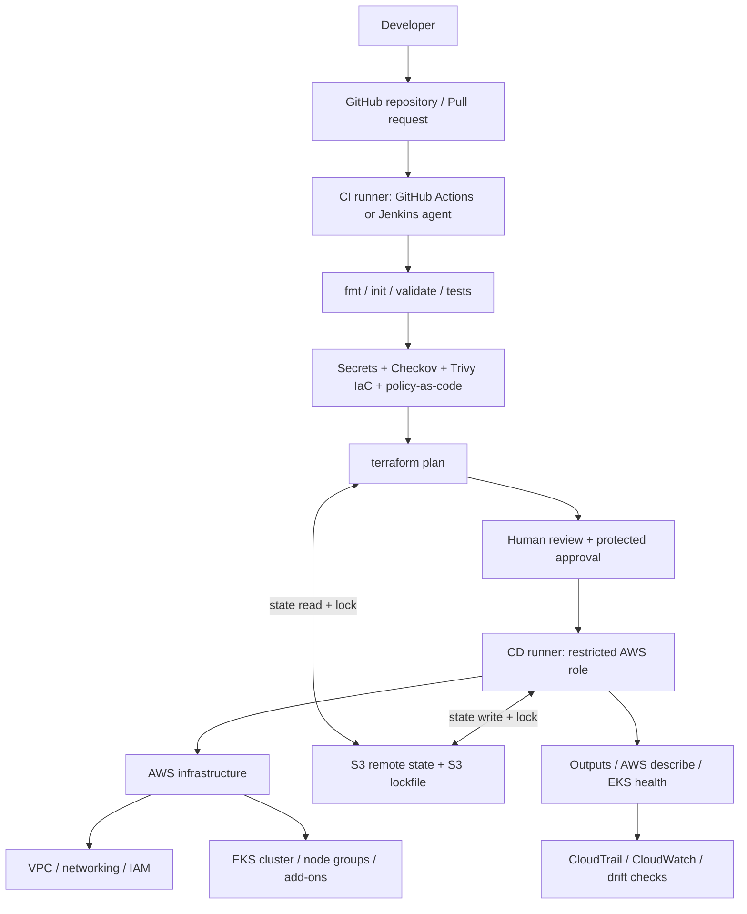
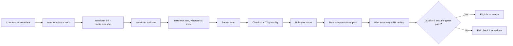
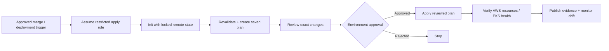
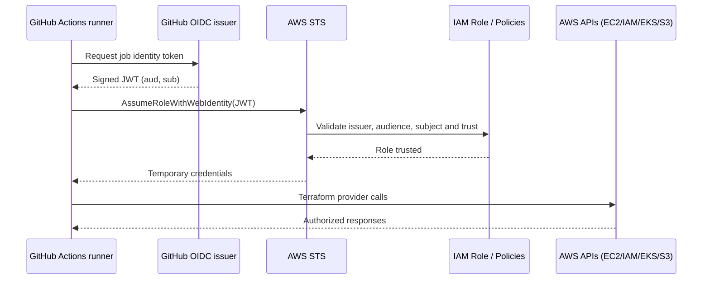
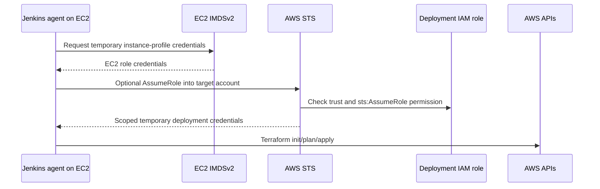

Enterprise Terraform IaC CI/CD Pipeline — AWS EKS
> **Reference project:** [terraform-module-eks-example](https://github.com/SushmitaDalai/terraform-module-eks-example/tree/main)  
> **Purpose:** Senior DevOps / Platform Engineering interview preparation and an enterprise implementation blueprint.  
> **Scope:** Terraform infrastructure provisioning, static security checks, plan review, controlled apply, AWS authentication, remote state, post-apply validation, operational recovery.
> [!IMPORTANT]
> **Repository verification:** The linked repository could not be read through public GitHub access while this document was written. Therefore, the folder layout, resource names, backend, and modules below are **illustrative**, not asserted facts about the repository. Before using the commands, inspect the repository's real root modules, `module` blocks, variable files, provider versions, existing backend, and workflows. **No source code or pipeline was modified.** This README documents how to build an enterprise pipeline *around* an EKS Terraform module example rather than pretending an unverified CI/CD implementation already exists.
Table of contents
Architecture and what Terraform deploys
CI/CD pipeline at a glance
Stage-by-stage breakdown
Security gates and reporting
Remote state and locking
GitHub Actions authentication to AWS
Jenkins authentication to AWS
EKS permissions: provisioning vs kubectl
Example GitHub and Jenkins stage designs
Promotion, drift, and recovery
Validation commands and troubleshooting
Interview questions and model explanations
Official references
---
1. Architecture and what Terraform deploys
The target architecture is an AWS EKS platform provisioned by reusable Terraform modules. A typical platform has VPC networking, private/public subnets, route tables, NAT/Internet Gateways, security groups, IAM roles, an EKS control plane, managed node groups, and optionally cluster add-ons and access entries. Verify what this particular repository actually declares before describing any of these as implemented.

IaC pipeline versus application pipeline: This pipeline creates or changes AWS infrastructure with Terraform. It does not package Python images or deploy application Helm charts; those belong to the application's CI/CD pipeline. Terraform may also manage cluster bootstrap add-ons, but production systems often separate EKS infrastructure state from Kubernetes workload state to avoid provider bootstrap/circular-dependency issues.
Illustrative repository structure — confirm and adapt
```text
terraform-module-eks-example/
├── README.md                         # Existing repository documentation, if present
├── main.tf                           # Possible root module: inspect actual layout
├── variables.tf
├── outputs.tf
├── versions.tf
├── terraform.tfvars.example          # Template only; never commit secrets
├── modules/                          # OPTIONAL, only if repository has local modules
│   ├── vpc/
│   └── eks/
├── environments/                     # OPTIONAL recommended future structure
│   ├── dev/
│   ├── stage/
│   └── prod/
└── .github/workflows/                # OPTIONAL CI/CD workflows
```
Root module = the directory from which `terraform init/plan/apply` runs. Child module = Terraform configuration called with a `module` block. If the repository uses external modules from the Terraform Registry, it may not have a `modules/` directory. Do not execute `terraform apply` in a child-module source directory unless that directory is deliberately a deployable root.
---
2. CI/CD pipeline at a glance
Pull request (CI — validate and review, no production apply)

Protected branch (CD — controlled infrastructure deployment)

Important: A PR-generated plan is usually advisory. Do not blindly apply a plan from an untrusted PR or an outdated branch. In CD, create and approve a fresh plan against the target environment's current state, then apply that saved plan within the same trusted execution context or through an access-controlled encrypted artifact exchange.
Stage	Suggested tool	Expected result	Blocking failure
Checkout	Git	Trusted revision and context	Repository checkout fails
Formatting	`terraform fmt -check -recursive`	Consistent HCL	Formatting mismatch
Init/validation	Terraform	Providers/modules resolve; configuration valid	Init or validate error
Terraform tests	`terraform test`	Module behavior verified	Failed test (if configured)
Secret scanning	Trivy filesystem secret scan or Gitleaks	No exposed credentials	Confirmed secrets
IaC scanning	Checkov	AWS best-practice checks	Policy violations above threshold
IaC scanning	Trivy `config`	Terraform misconfiguration checks	High/Critical issues under policy
Policy-as-code	OPA/Conftest or Sentinel	Enterprise rules met	Forbidden changes
Plan	Terraform	Change set for review	Provider/auth/state errors or blocked changes
Approval	GitHub Environment / Jenkins gate	Authorized decision	No approval
Apply	Terraform saved plan	Provision/update AWS	Terraform apply error
Post-apply	AWS CLI / Terraform / kubectl	EKS resources healthy	Validation failures
---
3. Stage-by-stage breakdown
Stage 0 — Bootstrap dependencies (one-time platform setup)
Provision outside the target Terraform stack:
An S3 state bucket with versioning, encryption, public-access blocking and limited access.
Separate S3 state keys per environment; use native S3 lockfiles with a compatible Terraform version.
An AWS OIDC identity provider and dedicated GitHub plan and apply roles, or Jenkins execution roles.
Protected environments, approvals, isolated runners and audit logs.
Any required KMS key and access policy (if using SSE-KMS).
Why separate bootstrap? Terraform cannot reliably initialize an S3 backend in a bucket that does not yet exist. Make the state/backend bootstrap a separately governed stack.
Stage 1 — Trigger, checkout and provenance
PRs: checkout a pinned commit, do code-only validations, run a read-only plan only if safe credentials and trusted context are available. Merges: controlled release workflow on `main`; production: manual approval, environment restrictions and dedicated AWS role.
Record: repository, commit SHA, PR number, runner ID, Terraform CLI version, provider lockfile, AWS account and environment. Do not permit untrusted fork PRs to access AWS credentials or privileged self-hosted runners.
Stage 2 — Terraform formatting
```bash
terraform fmt -check -recursive
```
Checks HCL formatting. It does not validate cloud credentials, resource behavior or secure architecture.
Stage 3 — Initialize and validate
```bash
# Run from the verified root module directory
terraform init -backend=false -input=false
terraform validate -no-color
```
`-backend=false` allows static CI to validate module and provider configuration without connecting to production remote state. A later plan must run a proper `terraform init` against the intended backend. Commit `.terraform.lock.hcl` for repeatable provider selection and pin module/provider versions deliberately.
Stage 4 — Test Terraform modules
```bash
# Only if .tftest.hcl / .tftest.json tests are present
terraform test
```
`terraform test` runs Terraform-native assertions; tests may create actual infrastructure depending on their configuration. Prefer mock providers or controlled ephemeral test accounts where possible. Check whether tests exist in the repository before introducing this as a mandatory stage. For module contracts, test variable validation, outputs, security configurations, tagging and expected deployment relationships.
Stage 5 — Secret scanning
```bash
trivy fs --scanners secret --exit-code 1 .
```
Look for AWS keys, private keys, tokens and accidental secret files. Never commit `.tfstate`, `.tfplan`, `.terraform/`, credential files or secret-filled `.tfvars`. A secret scanner is not a replacement for pre-commit secret prevention, repository protection or secret rotation. If an exposed AWS key is detected, revoke/rotate it; deleting the commit alone is insufficient.
Stage 6 — Terraform static misconfiguration scanning
Checkov:
```bash
checkov --directory . --framework terraform
```
Trivy configuration scanner:
```bash
trivy config --severity HIGH,CRITICAL --exit-code 1 .
```
Common findings: public control-plane endpoints or exposed ingress, permissive security-group rules, unencrypted storage, missing audit logs, unapproved instance types, insecure IAM privileges and untagged resources. Scanners are complementary: they can use different rules and may produce false positives. Document risk exceptions with owners, expiry dates and review records rather than silently disabling rules.
> **SCA distinction:** OWASP Dependency-Check is primarily an application dependency SCA tool. It is **not** the main Terraform security scanner. For IaC prioritize Checkov/Trivy and policy-as-code; separately keep Terraform providers, modules, action/plugin dependencies, and CI runner images updated.
Stage 7 — Custom organization policy-as-code
Suggested controls (examples, not claims about this repository):
EKS cluster control plane logging enabled.
EKS endpoint private or tightly restricted according to operating requirements.
Worker nodes in private subnets; no unrestricted SSH/RDP ingress.
IAM wildcards and `AdministratorAccess` forbidden without approved exceptions.
Mandatory tags (`Environment`, `Owner`, `CostCenter`).
Approved regions, KMS keys, node types and module versions.
Production EKS cluster and state bucket cannot be destroyed without break-glass approval.
Use OPA/Conftest with validated Terraform plan JSON, Checkov custom policies, or Terraform Cloud/Enterprise governance, depending on the platform. Policy rules must be tested and version-controlled.
Stage 8 — Terraform plan (controlled AWS read access)
```bash
terraform init -input=false -reconfigure \
  -backend-config="bucket=REPLACE_STATE_BUCKET" \
  -backend-config="key=eks/dev/terraform.tfstate" \
  -backend-config="region=ap-south-1"

terraform plan -input=false -lock-timeout=5m \
  -var-file=dev.tfvars \
  -out=tfplan

terraform show -no-color tfplan
```
The root module must already declare the appropriate backend block. Backend arguments above are examples, and `dev.tfvars` must exist at the appropriate environment path. Use an environment-specific state key and inputs. The saved plan file contains sensitive values potentially in readable form; treat it as a secret, encrypt/restrict access, retain briefly and never post raw JSON to a public pull request.
Use `terraform plan -detailed-exitcode` when scripting drift/change detection: exit 0 = no changes, 2 = changes, 1 = error. If output is piped to `tee`, use `set -o pipefail` or explicitly capture the Terraform exit code.
Stage 9 — Plan security and review
Static scans do not fully reflect resolved module or provider configuration. For deeper checks, generate a Terraform plan JSON file in a trusted environment and scan with tools that support `terraform_plan`/`terraformplan-json` before apply. Restrict access to the plan JSON: sensitive information may appear even where Terraform console output is redacted.
Review `+ create`, `~ update`, `-/+ replace` and `- destroy`. Require explicit escalation for replacement of EKS clusters, destructive subnet changes, or changes to IAM roles, networking and state-related resources.
Stage 10 — Approval and change control
Use GitHub protected environments / required reviewers, or Jenkins `input` and enterprise approval controls. Production uses a dedicated deployment runner and restricted IAM apply role. The approver should review the exact plan destined for execution; an approval for a stale PR plan is insufficient.
Stage 11 — Apply the approved plan
```bash
terraform apply -input=false -lock-timeout=5m tfplan
```
`terraform apply tfplan` applies the saved change set without re-planning. Confirm that source revision, input vars, backend key, account and plan artifact are unchanged from what was approved. Use concurrency controls so only one apply per environment can run at a time; S3 locking provides an additional protection against concurrent state changes.
No automatic `terraform destroy`, `-lock=false`, or blind `-auto-approve` in production. Applying an approved saved plan is intentionally non-interactive; human authorization must occur before the command.
Stage 12 — Post-deployment verification
```bash
aws sts get-caller-identity
aws eks list-clusters --region ap-south-1
aws eks describe-cluster --region ap-south-1 --name REPLACE_CLUSTER_NAME \
  --query 'cluster.{status:status,version:version,endpoint:endpoint}'

# Only when this role is authorized in EKS and network path exists:
aws eks update-kubeconfig --region ap-south-1 --name REPLACE_CLUSTER_NAME
kubectl get nodes
kubectl get pods -n kube-system
```
Validate VPC/subnet tags and routes, node-group health, EKS add-ons, CloudWatch logs and IAM/access entries as relevant to the repository. Remember: Terraform creating an EKS cluster does not inherently grant the pipeline Kubernetes API rights.
Stage 13 — Publish evidence and monitor
Archive the stage results, sanitized plan summary, Checkov/Trivy findings, policy decisions, approval metadata and deployment logs. Forward security findings to DefectDojo or an approved security platform via a verified integration; AWS Security Hub requires supported findings or a properly configured ingestion mechanism. Run scheduled drift detection and alert owners instead of auto-applying every drift correction.
---
4. Security gates and reporting
Control	Example gate	Failure action	Artifacts
Formatting/validation	Any error	Stop pipeline	CLI logs
Terraform test	Failed assertion	Stop pipeline	Test/JUnit logs if configured
Secrets	Any confirmed hardcoded secret	Stop + revoke exposed credential	Redacted scan report
Checkov	Fail on configured critical controls	Stop or approved exception	JSON/JUnit/SARIF
Trivy IaC	HIGH/CRITICAL misconfiguration	Stop or approved exception	JSON/SARIF
Organization policy	Prohibited IAM/network/state action	Stop	Policy evaluation evidence
Plan review	Destructive or expensive changes	Escalate approval	Sanitized plan summary
Drift	Unapproved changes	Alert and investigate	Drift report
Post-apply	Unhealthy EKS/node group	Incident + remediation	Health evidence
Avoid a common trap: do not put a `|| true` after a scanner in the actual enforcing stage. If reporting must always happen, capture scanner exit status, publish reports in a `finally` / `always()` block, and then fail the job based on policy.
5. Remote state and locking
Terraform state is an operationally sensitive database of managed resource identities and potentially secrets. The enterprise pipeline should use a remote S3 backend, bucket encryption, versioning, tightly scoped access, CloudTrail data events where appropriate, backups and native S3 locking (`use_lockfile = true`) on supported Terraform versions.
Illustrative backend block inside the root module:
```hcl
terraform {
  backend "s3" {
    bucket       = "REPLACE-terraform-state"
    key          = "eks/dev/terraform.tfstate"
    region       = "ap-south-1"
    encrypt      = true
    use_lockfile = true
  }
}
```
For multi-environment use, avoid hardcoding the environment-specific key in a shared root module; use partial backend configuration and environment-specific `-backend-config`. Create the bucket separately before `terraform init` and carefully control any migration from an existing local/DynamoDB-backed state. DynamoDB-based locking is deprecated in newer Terraform; use S3 native lockfiles for new compatible setups.
Recommended isolation: one state key per environment and independently deployable stack. Larger enterprises often use separate AWS accounts for dev, stage and production as well. Do not treat workspaces alone as a security boundary.
6. GitHub Actions authentication to AWS

In AWS IAM → Identity providers, create an OpenID Connect provider for `https://token.actions.githubusercontent.com`, audience `sts.amazonaws.com`. Not IAM Identity Center.
Create separate roles, e.g. `github-terraform-plan-dev` (limited read/plan) and `github-terraform-apply-prod` (approved resource mutations).
Scope each role's trust policy to specific `aud` and `sub` claims. Example for a protected GitHub environment:
```json
{
  "Version": "2012-10-17",
  "Statement": [{
    "Effect": "Allow",
    "Principal": {
      "Federated": "arn:aws:iam::123456789012:oidc-provider/token.actions.githubusercontent.com"
    },
    "Action": "sts:AssumeRoleWithWebIdentity",
    "Condition": {
      "StringEquals": {
        "token.actions.githubusercontent.com:aud": "sts.amazonaws.com",
        "token.actions.githubusercontent.com:sub": "repo:SushmitaDalai/terraform-module-eks-example:environment:production"
      }
    }
  }]
}
```
A GitHub Actions job requests an ID token, which `aws-actions/configure-aws-credentials` exchanges for temporary AWS credentials:
```yaml
permissions:
  contents: read
  id-token: write

jobs:
  apply:
    runs-on: ubuntu-latest
    environment: production
    steps:
      - uses: actions/checkout@v4
      - uses: aws-actions/configure-aws-credentials@v4
        with:
          role-to-assume: arn:aws:iam::123456789012:role/github-terraform-apply-prod
          aws-region: ap-south-1
      - run: aws sts get-caller-identity
```
Important: This illustrates authentication, not a complete workflow. The `sub` for a job using a GitHub Environment differs from a branch-based subject; the GitHub environment must be protected from unauthorized deployments. Pin action versions/SHAs based on enterprise policy. No permanent AWS access keys are needed. The trust policy decides who can assume, while attached IAM policies decide what AWS resources can be changed.
AWS permissions by phase:
Plan role: S3 read and locking as required for remote state; provider read/list/describe calls for resources under management; possible additional permissions to refresh state or query IAM.
Apply role: exact EC2/VPC/EKS/IAM and related permissions required by the verified module, plus backend state read/write/lock access. Creating IAM roles often requires stricter controls such as permissions boundaries and `iam:PassRole` scoped to approved roles/services.
State access: restrict the state bucket/key with IAM and bucket policies; decrypt permissions if using a customer KMS key. Separate permissions for S3 lockfile objects (`.tflock`).
Avoid a generic `AdministratorAccess` role, especially for automatic PRs. Build the real permission scope from Terraform resources, CloudTrail evidence and reviews.
GitHub-hosted versus AWS-hosted runners
GitHub-hosted: easiest; use GitHub OIDC, but private EKS/API/endpoints need suitable network connectivity or a separate AWS runner.
Ephemeral EC2 self-hosted: run job on short-lived EC2 in private subnets; optionally use OIDC for job-specific access, even if EC2 has a narrow base role.
ARC on EKS: use short-lived runner pods in a dedicated runner cluster; never mix untrusted build code with privileged production workloads without strong isolation.
CodeBuild-hosted GitHub runner: AWS-managed job execution with controlled VPC integration.
For infrastructure that modifies production, dedicate a protected CD runner group/environment; do not let untrusted PRs execute on privileged runners.
7. Jenkins authentication to AWS

Enterprise topology: private Jenkins controller (EC2 or Kubernetes), no builds on controller, ephemeral EC2 or Kubernetes agents, restricted management ingress, dedicated production deploy agents, backups, updates, RBAC and audit. The job runs on the agent; a controller instance role is not magically inherited by independent agents.
Jenkins agent on EC2
Attach an EC2 instance profile to the EC2 agent and require IMDSv2.
EC2 instance's trusted principal is `ec2.amazonaws.com` (not the GitHub OIDC provider).
The AWS CLI automatically obtains the instance's temporary credentials unless another credential source overrides them.
Prefer a low-privilege EC2 base role that can assume a dedicated IaC plan/apply role in the target AWS account.
Base-role trust (attached as an instance profile):
```json
{
  "Version": "2012-10-17",
  "Statement": [{
    "Effect": "Allow",
    "Principal": {"Service": "ec2.amazonaws.com"},
    "Action": "sts:AssumeRole"
  }]
}
```
Target deployment role trust (replace account and role):
```json
{
  "Version": "2012-10-17",
  "Statement": [{
    "Effect": "Allow",
    "Principal": {"AWS": "arn:aws:iam::111111111111:role/jenkins-agent-base"},
    "Action": "sts:AssumeRole"
  }]
}
```
The source role must also have an identity policy granting `sts:AssumeRole` on the target role. The target role needs narrow Terraform provider/backend permissions. In Jenkins, use AWS SDK/CLI credential providers or a carefully governed role-assumption wrapper. Keep credentials out of console logs and never save them to the workspace.
Agents on EKS: the runner/agent pod can use EKS Pod Identity or, if required, IRSA. This is a different identity flow from GitHub OIDC. Avoid giving an entire shared agent node a powerful role; restrict EC2 metadata access and isolate service accounts.
Example Jenkins stages (conceptual, not an installed Jenkinsfile)
```groovy
pipeline {
  agent { label 'terraform-aws' }
  options { timestamps(); disableConcurrentBuilds() }
  stages {
    stage('Validate') { steps { sh 'terraform fmt -check -recursive && terraform init -backend=false -input=false && terraform validate' } }
    stage('Security') { steps { sh 'trivy fs --scanners secret --exit-code 1 . && checkov -d . --framework terraform && trivy config --severity HIGH,CRITICAL --exit-code 1 .' } }
    stage('Plan') { steps { sh 'aws sts get-caller-identity && terraform init -input=false && terraform plan -input=false -out=tfplan' } }
    stage('Approval') { steps { input message: 'Approve the reviewed Terraform plan?' } }
    stage('Apply') { steps { sh 'terraform apply -input=false tfplan' } }
  }
}
```
> **Security caveat:** The above is a **teaching sketch**, not a production-ready Jenkinsfile. An actual design must handle separate IAM identities, separate environments, correct backend, trusted commit and protected branch checks, gated environments, encrypted/restricted plan artifact access, non-privileged agents, scanner reporting and cleanup. `disableConcurrentBuilds()` only protects that Jenkins job; other pipelines can still contend for state, so use backend locking.
8. EKS permissions: provisioning vs kubectl
Terraform's AWS provider can create and manage EKS resources with AWS IAM permissions such as `eks:CreateCluster`, `eks:DescribeCluster`, `eks:UpdateClusterConfig`, plus EC2, IAM, KMS and other actions determined by the actual modules. It does not necessarily need Kubernetes API authorization to create EKS via AWS APIs.
If the Terraform root also uses `kubernetes`, `helm`, or `kubectl` providers, the pipeline then needs EKS Kubernetes authentication/authorization, often through an EKS access entry for its IAM role plus an associated EKS access policy or Kubernetes RBAC mapping:
```bash
aws eks update-kubeconfig --region ap-south-1 --name REPLACE_CLUSTER_NAME
kubectl auth can-i create deployments -n REPLACE_NAMESPACE
kubectl get nodes
```
`aws eks update-kubeconfig` fetches cluster connection data; it does not grant EKS access. `eks:DescribeCluster` alone is also insufficient for Kubernetes operations. Prefer a separate, least-privilege cluster add-ons/Helm role if your IaC layout requires Kubernetes API access; avoid giving the generic Terraform role cluster-admin privileges.
Bootstrap recommendation: separate AWS-side EKS provisioning (cluster, VPC, node groups) from Kubernetes-side resources (add-ons, namespaces, charts) into independently managed states or stages. This avoids Kubernetes provider initialization dependencies on a cluster that does not exist yet.
9. Example GitHub and Jenkins stage designs
This is a stage contract, not code known to exist in the repository. Align paths (`.` versus `environments/dev`), variables and backend configuration after inspecting actual files.
Purpose	GitHub Actions	Jenkins
PR trigger	`pull_request`	GitHub PR webhook / multibranch pipeline
Runner	GitHub-hosted or private ephemeral AWS runner	EC2/EKS ephemeral agent
Check out	`actions/checkout`	`checkout scm`
Toolchain	Pinned Terraform and scanner versions	Pinned agent AMI/container image
Validate	`terraform fmt/init/validate`	Same shell commands
Security	Trivy secrets + Checkov + Trivy config	Same shell commands
Plan	OIDC plan role	EC2 profile → `AssumeRole`
Approval	Protected GitHub Environment	`input` + protected Jenkins permissions
Apply	OIDC apply role	Dedicated apply role, private agent
Results	Workflow artifacts / review / CloudWatch	Build artifacts / logs / CloudWatch
Example deploy lifecycle
```text
PR #123 (feature/eks-network)
  -> fmt, validate, tests, secret scan, IaC security, policy check
  -> advisory plan in DEV account; sanitized summary attached to PR
  -> merge after review

main -> deployment/dev
  -> fresh plan with DEV state and plan IAM role
  -> dev approval (optional) -> apply via DEV apply role
  -> verify EKS / networking / logs

release -> deployment/prod
  -> fresh plan with PROD state and plan IAM role
  -> review changes and explicit production approval
  -> apply exact plan via PROD apply role
  -> verify; preserve evidence; monitor for drift
```
Do not promote dev state to prod. Promote reviewed Terraform code and module versions, but generate distinct plans against each environment's actual state and inputs.
10. Promotion, drift, and recovery
Drift detection
Schedule a read-only plan against deployed state, e.g. daily or weekly depending on risk. Use `terraform plan -detailed-exitcode`; alert on exit 2 and investigate whether the change is intended, an out-of-band console edit, a provider behavior change or input drift. Do not auto-apply infrastructure changes to production simply because drift was detected.
Terraform rollback is not like Helm rollback
Terraform has no universal transaction rollback. If apply partially fails, some AWS resources may exist; Terraform state generally records successfully managed changes. A previous S3 state version is not necessarily a safe infrastructure rollback. Preferred recovery:
Stop concurrent applies and preserve logs/state snapshots.
Inspect actual AWS resources, Terraform state and the failure cause.
Fix configuration/permissions or revert the commit and create a new plan.
Assess potentially destructive effects (EKS recreation, deleted networking, changed IAM).
Obtain approval and apply the new plan. Restore state versions only under a documented incident runbook with expert review.
Critical production risks
State lock contention: wait or resolve the owning job; `terraform force-unlock` only when you have verified the lock is stale and understand the implications.
State leakage: rotate compromised secrets, lock down affected buckets/artifacts and audit access.
EKS cluster replacement: prohibit unreviewed destroy/replace; consider resource `prevent_destroy` selectively, but do not treat it as an absolute organizational guardrail.
Provider/module upgrades: pin compatible versions, read changelogs, validate in lower environments first.
Out-of-band edits: detect with drift, decide to import/reconcile or revert manually.
Loss of runner: reschedule job with an ephemeral agent; state and approvals must remain external to the runner.
11. Validation commands and troubleshooting
```bash
# Identify repo structure before documenting real modules
find . -maxdepth 3 -type f \( -name '*.tf' -o -name '*.tfvars' -o -name '*.tftest.hcl' \) | sort
rg '^module\s+"|^resource\s+"|^terraform\s*\{|backend\s+"|required_providers' --glob '*.tf' .

# Source validation
terraform version
terraform fmt -check -recursive
terraform init -backend=false -input=false
terraform validate -no-color

# Security validation
trivy fs --scanners secret --exit-code 1 .
checkov -d . --framework terraform
trivy config --severity HIGH,CRITICAL --exit-code 1 .

# AWS identity
aws sts get-caller-identity
aws configure list

# State and plan (only with authorized role and correct backend)
terraform state list
terraform plan -input=false -lock-timeout=5m -out=tfplan
terraform show -no-color tfplan

# EKS validation after apply (cluster name must be real)
aws eks describe-cluster --region ap-south-1 --name REPLACE_CLUSTER_NAME
aws eks list-nodegroups --region ap-south-1 --cluster-name REPLACE_CLUSTER_NAME
```
Symptom	Likely cause	First checks
`terraform init` fails	Backend access, invalid provider version, network	Terraform CLI version, S3 policy, module source
`AccessDenied` on state	S3/KMS/.tflock permission missing	Caller identity, bucket/key/KMS policies
`Error acquiring state lock`	Concurrent plan/apply	Current deployment jobs and lock owner
GitHub OIDC role denied	Wrong `sub`/`aud` or role trust	GitHub environment/branch, trust condition
Jenkins has wrong identity	Job executes on a different agent or env credentials override instance role	`aws sts get-caller-identity`, credential chain
Checkov/Trivy fails	Misconfiguration or risk policy	Rule ID, affected resource, exception workflow
Plan shows unexpected replace	Immutable AWS argument, module/provider upgrade, drift	`terraform show`, module changelog, state diff
Apply failed halfway	API quota, missing permissions, dependency timing	Terraform logs, AWS resource state, safe re-plan
`kubectl Unauthorized`	Missing EKS access entry / RBAC	IAM principal, EKS auth mode, access entry
`kubectl` times out	Private endpoint networking / DNS / SG	Runner VPC path, endpoint, DNS
12. Interview questions and model explanations
How is Terraform IaC CI different from application CI? Terraform validates and plans infrastructure changes, while application CI builds/tests software artifacts. No Docker image is required to deploy Terraform itself.
Why run `fmt`, `validate`, and Checkov? Format checks style, validate checks Terraform configuration and dependencies, Checkov detects policy/security misconfigurations; they cover different risks.
Why use remote state? Shared, durable, access-controlled state enables collaboration and audit; encryption and locking prevent many operational issues.
Why S3 native lockfiles? They coordinate access to state; a lock helps prevent concurrent state writes. Confirm Terraform version support.
How does GitHub authenticate? Signed GitHub OIDC token → STS `AssumeRoleWithWebIdentity` → temporary credentials → AWS provider calls.
How does Jenkins on EC2 authenticate? EC2 instance profile via IMDSv2, optionally followed by STS `AssumeRole` into the target account.
Why use separate plan and apply roles? Plan is primarily observation; apply can mutate critical infrastructure. Separate least-privilege roles limit blast radius.
Can untrusted PRs run plans? Not with privileged AWS credentials. Use code-only scans for forks, or tightly scoped, safely isolated read-only contexts with trusted workflow configuration.
Why approve saved plans? So humans review the exact infrastructure changes that Terraform will apply, avoiding hidden re-planning at deployment time.
What is in a Terraform plan file? It can contain sensitive values and must be treated as an access-controlled secret artifact.
How do you prevent destroying production EKS accidentally? Block destructive changes with policy, require elevated approval, separate roles/state, review replacements, add resource-level safeguards where appropriate.
Can Terraform roll back automatically? Not generally. Recovery is a reviewed new plan, not blindly restoring old state.
Why separate EKS and Kubernetes resources? Different provider lifecycle and authentication dependencies, clearer ownership and smaller state blast radius.
Does `eks:DescribeCluster` authorize kubectl? No. Kubernetes authorization requires EKS access entry / access policy and/or Kubernetes RBAC.
How do enterprises manage drift? Scheduled read-only plans, alerts, investigation, and approved remediation.
How do you deploy the same module to dev/stage/prod? Immutable module versions plus separate account/inputs/state; independent plans and approvals per environment.
How do you fail the pipeline and still publish findings? Store the scanner exit status, upload scrubbed reports using `always()`/`post { always { ... } }`, then enforce the result.
What do you monitor after Terraform apply? Resource status, node health, network routing, control-plane logs, security configuration, drift and cost signals.
Suggested 90-second interview answer
> "For our EKS infrastructure, I would treat Terraform as a separate IaC delivery pipeline. A pull request triggers formatting, initialization without backend access, validation, module tests, secret scanning, Checkov and Trivy IaC scans, followed by organization policy checks. If required controls fail, we block the PR. With tightly restricted credentials, we generate an advisory plan for review. After merge, the deployment workflow assumes a separate AWS apply role, initializes environment-specific encrypted remote state with locking, generates a fresh plan, and requires approval for sensitive production changes. We apply the exact approved plan and validate EKS, node groups and networking. GitHub Actions can federate to AWS using OIDC; Jenkins agents on EC2 use an instance profile and optionally assume a target role. We keep plan and apply roles separate, protect state and plan artifacts, and run scheduled drift detection. Since Terraform has no general automatic rollback, recovery is performed with a reviewed corrective plan."
13. Official references
Repository requested for this example
Terraform automation
Terraform S3 backend and state locking
Terraform plan command and sensitive plan files
Terraform test
Checkov CLI
Trivy Terraform configuration scanning
AWS credentials action and OIDC guidance
AWS EKS access entries
Jenkins controller/agent architecture
---
Next integration step: After the repository contents are accessible, replace illustrative names and paths with its actual Terraform module calls, resource inventory, variables, environments and backend. Then add links to the real workflow files or implement them as a separate change. This document intentionally does not claim those implementations already exist.
