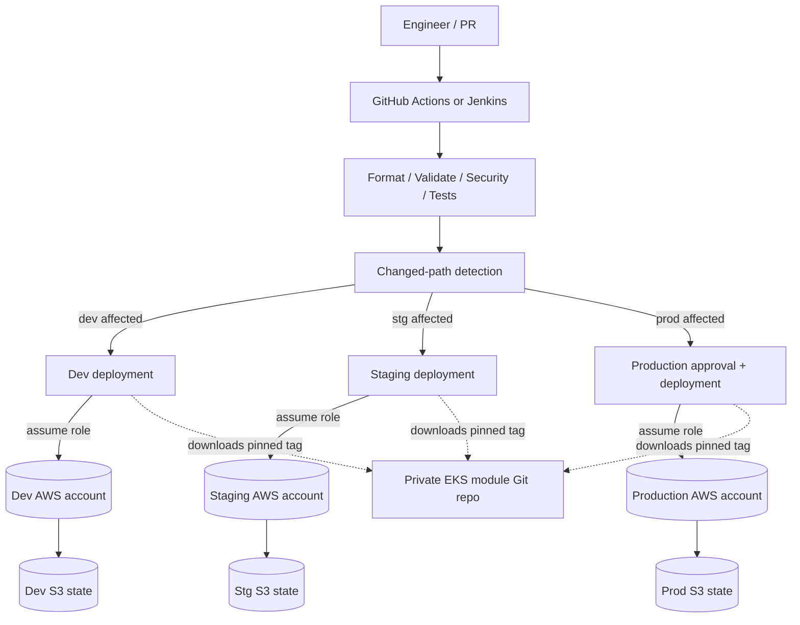
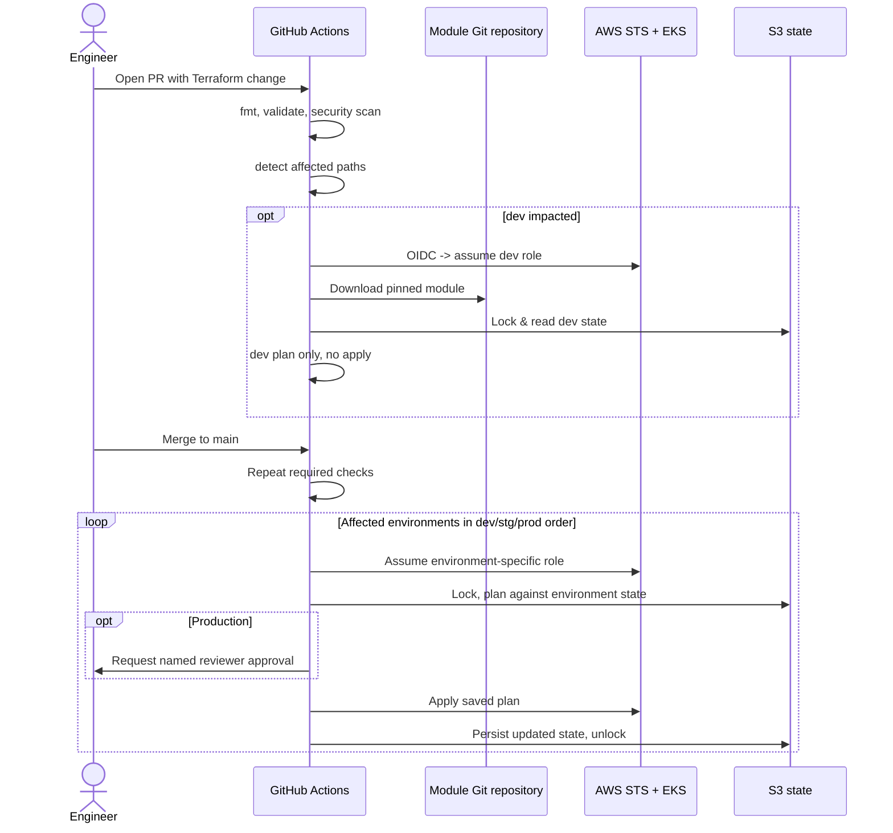
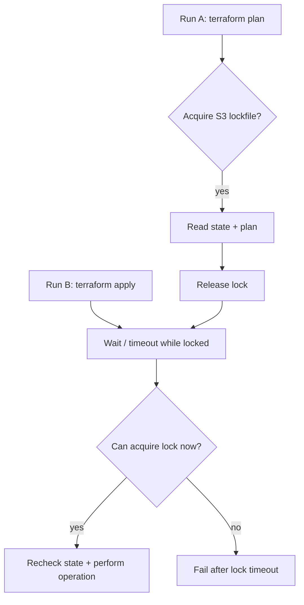
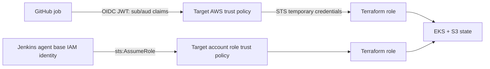
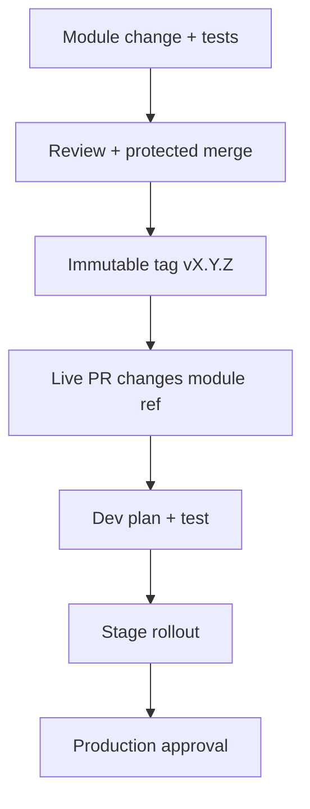

# Terraform Multi-Environment, Multi-Account EKS Deployment

> **A senior engineer's field guide to architecture, state, modules, security, CI/CD, operations, and interviews**
>
> **Repository:** https://github.com/SushmitaDalai/terraform-module-eks-example  
> **Status:** technical learning/reference implementation; not evidence of a successful production deployment.  
> **Evidence standard:** **Observed** means visible in the supplied code/screenshots or public repository landing page; **Proposed** is a recommended extension; **Verify** means check the linked file or your AWS/GitHub/Jenkins configuration before relying on it.

## Contents

1. [Purpose, audience, and source of truth](#1-purpose-audience-and-source-of-truth)
2. [Architecture and repository map](#2-architecture-and-repository-map)
3. [How to set up and deploy](#3-how-to-set-up-and-deploy)
4. [Architecture decision log](#4-architecture-decision-log)
5. [End-to-end deployment flows](#5-end-to-end-deployment-flows)
6. [Terraform concepts and failure modes](#6-terraform-concepts-and-failure-modes)
7. [Security, EKS, and governance deep dives](#7-security-eks-and-governance-deep-dives)
8. [Operations: troubleshooting and incident response](#8-operations-troubleshooting-and-incident-response)
9. [Real-world failure scenarios](#9-real-world-failure-scenarios)
10. [Interview question bank (42 questions)](#10-interview-question-bank-42-questions)
11. [Hands-on labs (8)](#11-hands-on-labs-8)
12. [Quick-reference cheat sheet](#12-quick-reference-cheat-sheet)
13. [Verification, limitations, and next steps](#13-verification-limitations-and-next-steps)

---

## 1. Purpose, audience, and source of truth

This repository illustrates how an engineer can use a **single Terraform root module** with distinct configuration and state for `dev`, `stg`, and `prod` AWS accounts, while consuming a separately versioned EKS module. It is designed to demonstrate *why* separation and security boundaries matter, not merely how to type `terraform apply`.

**Audience:** DevOps/cloud engineers, senior engineers, platform engineers, technical reviewers, and interview candidates. The narrative deliberately distinguishes observed code from recommended production hardening.

**What was checked for this document:** The public repository landing page and supplied screenshots, the earlier Task 1 source ZIP, the screenshot of the final VS Code layout, and the locally supplied GitHub Actions workflow files. **Important:** The Task 1 ZIP predates the final `iac/eks` restructuring, so the **final layout in the screenshot takes precedence**. The public GitHub listing confirmed the repository exists; individual nested files and Jenkins files were not all retrievable. Do not assume that an example command or recommended policy has already been deployed.

**Project-specific values you must fill in:** `[ORG]`, `[ACCOUNT_DEV]`, `[ACCOUNT_STG]`, `[ACCOUNT_PROD]`, `[REGION]`, `[VPC_ID]`, `[PRIVATE_SUBNET_IDS]`, `[STATE_BUCKET]`, `[KMS_KEY_ARN]`, `[GITHUB_REVIEWERS]`, `[JENKINS_BASE_ROLE]`, `[REAL_MODULE_REPO]`. Placeholder AWS account IDs such as `111111111111` are **not** real account data.

### Core model

- **Live root:** defines the deployment instance: environment, account, VPC/subnets, versions, tags, and module source.
- **Module repository:** defines reusable implementation: EKS, IAM roles, node groups, add-ons, optional encryption, and outputs.
- **Remote state:** holds Terraform's recorded resource identities and attributes, isolated by environment/component.
- **CI/CD:** validates every change; plans affected environments; applies only according to branch and approval rules.
- **AWS role boundary:** each target account controls whether a pipeline identity may assume a deployment role.

## 2. Architecture and repository map

### Final live repository structure (Observed from final VS Code screenshot)

```text
terraform-module-eks-example/
└── infrastructure-live/
    ├── .github/
    │   └── workflows/
    │       ├── pipeline.yml                 # main orchestration (provided separately)
    │       └── terraform-deploy.yml         # reusable deployment worker (provided separately)
    ├── config/
    │   ├── dev/
    │   │   ├── backend.hcl
    │   │   └── dev.tfvars
    │   ├── stg/
    │   │   ├── backend.hcl
    │   │   └── stg.tfvars
    │   └── prod/
    │       ├── backend.hcl
    │       └── prod.tfvars
    ├── iac/
    │   └── eks/
    │       ├── backend.tf
    │       ├── main.tf
    │       ├── outputs.tf
    │       ├── providers.tf
    │       ├── variables.tf
    │       ├── versions.tf
    │       └── README.md
    ├── .gitignore
    └── README.md
```

The **module repository** is a logically separate Git repository, not necessarily a sibling directory of this public repository:

```text
terraform-modules/
└── eks/
    ├── main.tf
    ├── variables.tf
    ├── outputs.tf
    ├── versions.tf
    ├── tests/
    │   └── eks.tftest.hcl
    └── examples/basic/main.tf
```

The screenshots for Task 2 also propose `infrastructure-live/Jenkinsfile`, `infrastructure-live/jenkins/terraformDeploy.groovy`, `terraform-modules/Jenkinsfile`, and `.github/workflows/module-ci.yml` in the module repo. **Verify their presence**: they were requested, but not proven to be committed in the public repository.

### Architecture overview



**Why this design matters:** the code is shared, but the execution identities and states are not. A dev change must not accidentally become a production state update; the backend bucket/key and deployment account must agree with the environment.

## 3. How to set up and deploy

### Prerequisites

1. Terraform compatible with the root's `required_version` (the earlier generated root requires **>= 1.11.0**; workflows provided in this conversation pin CLI **1.11.4**).
2. An AWS role in each account with least-privilege Terraform and remote-state access.
3. An existing VPC and private subnets in the target account, with EKS routing/endpoints designed for the workload.
4. One S3 state bucket per environment/account, created **before** executing Terraform; versioning, encryption, access controls, and lockfile support configured.
5. A private Git module repository containing the `eks` subdirectory and an immutable release tag (example `v1.0.0`).
6. A GitHub token or app credential with read-only access to the private module, or appropriately secured Jenkins credentials.
7. GitHub OIDC provider/trust policy in each AWS account and GitHub Environment protection on `prod`, if GitHub Actions is used.
8. Jenkins multibranch pipelines, agent tooling, AWS base identity, and AWS Pipeline Steps support if Jenkins is used.

### Verify the environment before planning

From `infrastructure-live/`:

```bash
terraform -version
aws sts get-caller-identity
cat config/dev/backend.hcl
cat config/dev/dev.tfvars
```

Do not post backend files or `.tfvars` in tickets without reviewing contents. Confirm the account ID, region, VPC/subnet list, Kubernetes version, and backend key. In the earlier Task 1 root, `allowed_account_ids = [var.account_id]` adds a **provider-side safety check**, but it does not replace a correctly scoped IAM trust policy or the backend credential boundary.

### Manual dev run (final structure)

```bash
cd infrastructure-live/iac/eks
terraform fmt -check -recursive
terraform init -reconfigure -input=false \
  -backend-config=../../config/dev/backend.hcl
terraform validate
terraform plan -input=false \
  -var-file=../../config/dev/dev.tfvars \
  -out=tfplan
terraform show tfplan
# Only after approval and account verification:
terraform apply -input=false tfplan
```

Repeat for `stg`/`prod` **only with their respective AWS identities, backends and variable files**. Do not reuse a saved plan for a different account or environment. Never commit `tfplan`, `.terraform/`, sensitive state, or credentials.

### Backend choice

The root declares an empty partial backend:

```hcl
terraform {
  backend "s3" {}
}
```

Each `config/<env>/backend.hcl` supplies environment-specific settings. In Terraform 1.11, an S3 backend can use native lockfiles via `use_lockfile = true`; modern Terraform supports this without introducing a DynamoDB lock table for new deployments. **Verify** the backend configuration and permissions for each AWS account. Backend configuration cannot reference ordinary input variables, because Terraform must initialize the backend before evaluating the root module.

### GitHub Actions (provided workflow strategy)

- `pipeline.yml`: trigger on PR/main changes, detect affected paths, format/validate/security scan, then invoke the worker.
- `terraform-deploy.yml`: consume `environment`, `role_arn`, `aws_region`, `component`, and `apply`; use GitHub OIDC; initialize backend; plan; apply only for allowed main-branch runs.
- The reusable workflow's default component is `eks`, so `working-directory: iac/eks`; backend path is `../../config/<env>/backend.hcl`.
- A production GitHub Environment with named required reviewers provides the approval gate. **A YAML environment name alone does not configure reviewers**—repository settings must do that.
- Pull requests plan dev only (when affected); successful main-branch pushes may apply dev → stg → prod in sequence, subject to change detection and approval.

**Critical path note:** GitHub only discovers Actions workflows under `.github/workflows/` at the **repository root**. If the Git repository root is `terraform-module-eks-example/` and `infrastructure-live/` is a subfolder, `infrastructure-live/.github/workflows/` will **not** be automatically discovered as a runnable GitHub Actions workflow. Either make `infrastructure-live` its own Git repository or place workflows at the outer repository's `.github/workflows/` and adjust their paths. Check this before diagnosing a "workflow not triggered" incident.

## 4. Architecture decision log

These are **rationale entries**, not claims that each option was experimentally tested. Review them as you would review an ADR (architecture decision record).

| ID | Context and options | Decision | Why / consequence | When to revisit |
|---|---|---|---|---|
| ADR-01 | One repo vs separated live/module repos | **Separate logical live root and reusable module** | Keeps rollout configuration distinct from shared resource implementation. Costs: version coordination and private repo access. | When many modules require unified release automation. |
| ADR-02 | One Terraform root per environment vs shared root plus config | **One root with per-env tfvars and backend.hcl** | Reduces drift between environments. Costs: stricter safeguards against wrong account/state. | When environments diverge materially in topology. |
| ADR-03 | CLI workspaces vs per-env state | **Explicit per-environment backend config** | Easier to audit account ownership; keys and IAM boundaries are visible. Workspaces alone are not security boundaries. | When testing short-lived homogeneous stacks in one trust zone. |
| ADR-04 | S3 native lockfile vs DynamoDB locking | **Use S3 `use_lockfile` for new Terraform 1.11 stacks** | Avoids a separate DynamoDB locking dependency; requires conditional S3 object permissions on lockfile paths. | If supporting older Terraform or migrating legacy backends. |
| ADR-05 | AWS static keys vs OIDC/role assumption | **OIDC for GitHub; base IAM identity + STS role assumption for Jenkins** | Short-lived credentials, centralized revocation and trust policy control. Costs: more IAM design. | If adopting stronger workload identity or hosted Jenkins OIDC. |
| ADR-06 | Git branches vs Git tags vs registry | **Pin an immutable Git tag (`ref=v1.0.0`)** | Reproducible module rollout; tag protection is required because Git tags can otherwise move. | If publishing to a private module registry. |
| ADR-07 | Provider configuration in module vs root | **Configure provider in live root** | The caller owns account/region and can reject account mismatches. Module declares provider requirements only. | If multi-region/multi-account providers require aliases. |
| ADR-08 | Commit provider lockfile vs regenerate | **Commit `.terraform.lock.hcl`** (requested practice; verify repository) | Pins provider selections/checksums for reviewable updates. Do not commit `.terraform/`. | When intentionally upgrading dependencies. |
| ADR-09 | Shared state vs account/environment state | **Unique state per component and environment** | Reduces blast radius and concurrent updates to unrelated stacks. Cost: orchestration of outputs/cross-stack dependencies. | If splitting a large root by responsibility. |
| ADR-10 | One deployment role vs plan/apply roles | **Simpler demo: same role for plan and apply** | Less pipeline code, but larger privileges during the planning phase. | Production hardening: separate read-only plan and write apply. |
| ADR-11 | Build plan and apply in one job vs distinct jobs | **Same job/stage for this example** | Saved `tfplan` is applied without recalculation. Drawback: prod approval occurs before plan visibility. | Approval must review exact saved binary plan. |
| ADR-12 | Always deploy all vs changed-path detection | **Plan/deploy only impacted envs** | Lower cost and faster CI. Risk: an incomplete diff can skip a required deployment. | When shared module version changes or change detection is unreliable. |
| ADR-13 | Security scan blocking vs reporting | **Non-blocking Checkov in demo** | Faster learning loop, but vulnerable settings could pass the build. | Before treating pipeline as production security gate. |
| ADR-14 | Managed node groups vs self-managed worker fleets | **EKS managed node groups** | AWS manages node lifecycle integration; fewer bespoke upgrades. Still requires AMI/version/capacity decisions. | Advanced workload isolation or custom node lifecycles. |
| ADR-15 | Public vs private EKS API | **Private access by default; restricted public only when justified** | Shrinks control-plane attack surface; private runner connectivity becomes a prerequisite. | If controlled external CI must access cluster API. |

### Lessons from the decision log

A good architecture choice minimizes *failure domains* rather than merely files. Splitting states makes rollback scopes smaller. Pinning modules makes changes deliberate. Explicit backend initialization prevents accidentally binding dev code to prod state. Conversely, extra isolation increases onboarding and credential complexity; the README must make those dependencies visible.

## 5. End-to-end deployment flows

### Flow A — Commit to AWS, including a pull request and merge



**Walkthrough:** The workflow first proves that syntax, providers and modules are coherent, then decides which account actually needs work. On main, each affected environment uses its own role, state configuration and input values. A skipped environment is **not** a failed deployment; downstream expressions must distinguish `success`, `skipped`, and `failure`. On PRs, `apply=false` must be enforced regardless of user-supplied workflow inputs.

### Flow B — State lock and concurrent runs



Terraform state locking protects a state object from simultaneous writers. **Workflow concurrency and Terraform locking solve different problems:** CI concurrency serializes jobs; the state lock protects the backend even if a user runs Terraform locally. Never use `-lock=false` to "fix" a busy backend. A stale lock must be diagnosed, not blindly removed.

### Flow C — Authentication: GitHub OIDC vs Jenkins



GitHub's identity token is not an AWS access key. AWS accepts it only when the target role's trust policy permits the correct issuer, audience and subject. Jenkins `withAWS(role: ..., roleAccount: ..., region: ...)` usually assumes a role from the agent's existing AWS identity; it is **not the same mechanism as GitHub OIDC**.

### Flow D — Change detection by example

| Changed paths | PR behavior | Main behavior |
|---|---|---|
| `iac/eks/main.tf` | Dev plan | Apply dev, stg, prod (if gates succeed) |
| `config/dev/dev.tfvars` | Dev plan | Apply dev |
| `config/stg/stg.tfvars` | Checks only | Apply stg |
| `config/prod/prod.tfvars` | Checks only | Approve/apply prod |
| `.github/workflows/pipeline.yml` | Checks only | Checks only |
| Unknown base commit on first build | Conservative change detection | Conservatively flag all; verify before applying |

The exact main workflow should be inspected for its skipped-job conditions; the table represents the **intended** strategy. A shared-module change in the *other repository* will not automatically update this live root until the module version reference changes or a deliberately authorized deployment is triggered.

### Flow E — Promotion and approval

Dev → staging → production is an **ordered eligibility policy**, not proof that a staging test passed merely because dev applied. Production promotion should additionally require a release artifact, change record, acceptance criteria, observability checks and an explicit named reviewer. The current simple worker combines plan/apply; a mature system splits a saved plan from apply and verifies its provenance before approval.

### Flow F — Module release and upgrade



A module tag is *not* automatically safe: review backwards compatibility, variable defaults, provider constraints, state schema, and EKS version changes. A module upgrade may alter dozens of resources even if only one root-line diff appears in Git.

## 6. Terraform concepts and failure modes

### State, desired configuration and reality

- **Configuration:** what the HCL declares.
- **State:** Terraform's remembered mapping between resource addresses and remote object IDs.
- **Real infrastructure:** what AWS currently contains.
- **Plan:** the proposed reconciliation, based on configuration, state, and refresh of provider-observed resources.

State is **not** a general backup of a cluster. Store it securely, turn on bucket versioning, review object-level access, and assume state may contain sensitive values even if Terraform output masks them. A state file must never be treated as a public artifact.

### `terraform init` and the partial backend

`init` downloads providers/modules and connects to backend state. `-reconfigure` tells Terraform to accept new backend settings without attempting automatic state migration. Switching `dev` → `prod` with a reused `.terraform` working directory is risky: always provide the correct backend and verify `aws sts get-caller-identity`. For a real state migration, use a reviewed `terraform init -migrate-state` procedure and backups—not `-reconfigure` as a migration shortcut.

### Variables vs outputs vs locals

`.tfvars` selects environment-specific inputs. A `local` computes a value inside the root/module. An `output` exposes a result after apply. Do **not** put provider secrets in public `.tfvars`; use IAM roles and secret-management integrations.

### Providers vs modules

The **provider** is Terraform's interface to AWS APIs; the **module** is a group of Terraform resources with an input/output contract. Pin the provider via version constraints and the checked-in lockfile. Pin modules to reviewed releases. A child module should declare `required_providers` but generally not configure its own AWS provider block, leaving account and region decisions with the root.

### Lifecycle and graph behavior

Terraform computes a dependency graph from references and explicit `depends_on`. A forced replacement may occur because an immutable AWS field changed. A lifecycle `precondition` can fail early with a human-readable message; `prevent_destroy` can be a guardrail but is not an authorization layer. `ignore_changes` should be narrow and documented: overusing it hides drift.

### `count`, `for_each`, and resource addresses

`count` uses numeric addresses such as `aws_instance.worker[0]`; inserting/removing earlier list elements can cause address churn. `for_each` uses stable keys such as `aws_eks_addon.managed["coredns"]`. Choose stable, business-meaningful keys. When refactoring addresses, use a `moved` block rather than destroying and recreating resources.

### Import, drift, and removal

`terraform import` associates an existing cloud object with a resource address; it does **not** automatically guarantee that your HCL describes every relevant attribute. Use `import` blocks where appropriate, run a plan, reconcile differences, and seek review. Use `removed` blocks for intentional abandonment of management, and distinguish that from deleting cloud resources. Drift must be assessed for intent before choosing refresh, code change, import, or revert.

### Locks and lockfiles

The `.terraform.lock.hcl` pins **provider selections and checksums**; the S3 `.tflock` protects **concurrent state operations**. They have different purposes. Neither is a secret-management tool. Commit the former; never commit Terraform state/lock artifacts.

### Testing pyramid

1. **Static:** `terraform fmt`, syntax, linting and policy/security scans.
2. **Validate:** `terraform init -backend=false` then `terraform validate` (module installation still requires module credentials).
3. **Unit-style Terraform tests:** `.tftest.hcl` with mocks to validate variables and resource behavior without provisioning AWS.
4. **Plan checks:** real account read permissions + correct state.
5. **Ephemeral integration tests:** provision disposable resources in a sandbox and destroy after tests.
6. **Production verification:** health, metrics, access, capacity and workload smoke tests.

A mocked provider test does **not** prove AWS IAM policies are sufficient, that the subnet routing works, or that a particular Kubernetes version is currently supported in the target region.

## 7. Security, EKS, and governance deep dives

### EKS and node-group controls (Observed in the earlier module source)

The initial EKS module includes cluster and worker IAM roles, managed node groups, CloudWatch cluster logs, core add-ons (`vpc-cni`, `kube-proxy`, `coredns`), an IAM OIDC provider, private endpoint access, optional public endpoint CIDRs, and optional KMS-backed secrets encryption. Verify current Git sources before assuming those settings are unchanged.

| Concern | Intended guardrail | Production review question |
|---|---|---|
| Cluster API | Private endpoint default; public CIDRs restricted | Can the runner reach the private endpoint if later steps call Kubernetes? |
| Secrets | KMS envelope encryption when enabled | Who controls key policy and rotation? What is the EKS-version behavior? |
| Audit | API, audit, authenticator, scheduler and controller manager logs | Is retention suitable for compliance and cost? |
| Worker access | Dedicated EC2 node role and managed policies | Can CNI permissions use a scoped role rather than broad node-role attachment? |
| Nodes | Managed groups, min/desired/max, instance type and capacity type | What is the capacity plan and Spot interruption strategy? |
| Identity | Cluster OIDC provider | Are workloads actually using IRSA or Pod Identity; what are their trust policies? |
| Add-ons | Managed VPC CNI/CoreDNS/kube-proxy | Are versions compatible with the specific Kubernetes upgrade? |
| Wrong account | `allowed_account_ids` provider guard | Does the backend also reside in the intended account? |

**EKS cluster OIDC vs GitHub OIDC:** They are separate issuers for separate purposes. EKS OIDC often supports IAM Roles for Service Accounts (IRSA) for Kubernetes workloads. GitHub OIDC supports CI workload federation to AWS. One provider cannot be substituted for the other.

### IAM policy design

Restrict the GitHub deploy role trust policy by `token.actions.githubusercontent.com:aud = sts.amazonaws.com` and a narrow `sub` identifying the intended repo/environment or branch. Where GitHub Environments are used, a subject might resemble `repo:[ORG]/[REPO]:environment:prod`; verify the exact subject format in the GitHub OIDC docs and your workflow. The role's **permission policy** then limits which EKS, IAM, EC2, CloudWatch and S3 actions are allowed.

**STS trust is only step one.** Permission to assume a role does not mean the role can create EKS clusters. Conversely, a powerful permissions policy is not safe if the trust policy allows arbitrary repositories to assume it.

### State bucket baseline

- Block public access and disable ACL-based public ownership where practical.
- Enable versioning; log and alert on unauthorized access or deletions.
- Encrypt at rest, preferably with an appropriately scoped KMS key and tested key policy.
- Grant S3 read/write for the exact state key and lockfile key; list the bucket with a narrow prefix condition.
- Keep state access separate across environments/accounts.
- Do not store credentials in `backend.hcl` or in CLI logs.
- Test recovery from a **copy** of a prior state version before a live restoration.

### Cost, policy and operations trade-offs

Spot nodes are cost-effective for interruption-tolerant workloads, not necessarily critical singleton workloads. Private endpoints limit reachability but introduce runner/network dependencies. More state shards reduce blast radius but increase cross-stack dependency management. Checkov in report-only mode gives visibility but **does not enforce policy**. A stronger design makes high-severity findings blocking and handles approved exceptions as reviewed waivers.

## 8. Operations: troubleshooting and incident response

### Triage order

1. **Stop speculative applies.** Capture branch, commit, environment, caller identity and timestamp.
2. **Confirm account and backend** using STS identity and the `backend.hcl` path.
3. **Classify the symptom:** checkout/authentication, initialization, state, provider validation, plan, apply, or post-deploy health.
4. **Read the exact error**, identify the earliest failing step, and avoid fixing later symptoms first.
5. **Recover with review:** a saved plan, state restoration, import, code correction, or controlled retry as appropriate.

### Troubleshooting table (24 cases)

| Symptom | Likely cause | First check / safe fix |
|---|---|---|
| Workflow never starts | Workflow in `infrastructure-live/.github` instead of repository root | Move to actual Git root `.github/workflows`; review branch/path filters. |
| `No such file backend.hcl` | Wrong Terraform working directory | Use `iac/eks` and `../../config/<env>/backend.hcl`. |
| Incorrect account in provider error | Role/account mismatch | Check `aws sts get-caller-identity`, role ARN and account-specific tfvars. |
| `AccessDenied` on state object | S3 permissions, key prefix or bucket policy | Inspect backend key, IAM policy and KMS key permissions. |
| Unable to acquire state lock | Another run or stale `.tflock` | Find active job first; use controlled unlock only after confirming no writer. |
| Terraform backend unexpectedly changed | Reused `.terraform` metadata | Inspect backend values; `init -reconfigure` only after verifying intended state. |
| Private module clone 403 | Token expired/lacks repository read scope | Reissue least-privilege token, audit Git rewrite config; don't print token. |
| `Failed to query available provider packages` | Network/provider mirror issue | Check provider source, proxy, egress, lockfile/platform. |
| Unexpected mass replacement | Module/provider change or address refactor | Stop; compare versions/addresses; consider `moved` blocks. |
| `Invalid for_each argument` | Keys unknown at plan time | Use plan-known stable keys; move unknown values into map values. |
| EKS create times out | Subnets, IAM, quotas or endpoint prerequisites | Check CloudTrail/EKS events, subnet routing and service quotas. |
| EKS node group `CREATE_FAILED` | Insufficient IAM, route/NAT, SG or AMI mismatch | Inspect node group health issues and EC2 instances. |
| Add-on update fails | Version incompatibility / conflicts | Check compatible versions and existing custom add-on settings. |
| `kms:Decrypt` denied | KMS key policy/IAM mismatch | Inspect role, encryption context, key policy and region. |
| OIDC `AccessDenied` / token rejected | Wrong issuer/audience/subject | Examine IAM trust conditions and GitHub job Environment. |
| Jenkins `withAWS` fails | Missing plugin/base role permissions | Check installed AWS Pipeline Steps plugin and agent identity. |
| PR ran apply | Incorrect workflow event/branch guard | Disable pipeline; inspect `apply` conditions and protected branch rules. |
| Prod deploy skipped unexpectedly | Upstream job was `skipped` | Evaluate `needs.*.result`, explicit `always()`/guards and change outputs. |
| Plan differs between runs | Drift, changing data, version mismatch | Pin versions; compare refresh results; avoid applying stale plans. |
| S3 `NoSuchBucket` | Backend bucket not bootstrapped | Provision and protect state bucket before running live root. |
| `terraform validate` cannot fetch module | `init -backend=false` still clones modules | Supply read-only Git credentials for validate job. |
| Workflow path filter misses edits | Repo-relative paths wrong | Reconcile Git root and changeset patterns. |
| Git diff reports nothing on first build | Shallow history / missing base commit | Fetch full history or use conservative all-affected behavior. |
| Terraform test passes but EKS breaks | Mocked provider cannot exercise AWS behavior | Add isolated integration tests and post-deploy checks. |

### Incident response: state lock / state corruption

**Lock:** Identify which run owns the lock, verify whether it is alive, and only then use a documented `terraform force-unlock <LOCK_ID>` procedure if there is no active writer. Force-unlock removes concurrency protection, not broken resources. **Corruption or wrong state:** stop applies; retain logs and original state objects; consult object versioning; compare resource bindings; test any restoration with read-only inspection and a plan. Do not casually replace live state with an older object while another run is active.

## 9. Real-world failure scenarios

These are **hypothetical drills**, not reports of incidents that occurred in this repository.

### Scenario 1 — Stuck lock

A PR runner times out while a colleague sees a lock error locally. The senior response is not `-lock=false`; it is to identify the holder via CI logs and `.tflock`, wait or safely terminate the abandoned run, and use forced unlock only with incident approval.

### Scenario 2 — Corrupted or overwritten state

An engineer points the prod backend at dev's key. Their plan proposes destructive "reconciliation". Halt immediately, validate key/bucket/account, compare state versions, and recover mappings under change control. Prevention: separate buckets, IAM prefixes, verified backend parameters, and pre-apply account checks.

### Scenario 3 — Wrong-account apply

A Jenkins agent inherits credentials from `[ACCOUNT_DEV]` while `prod.tfvars` expects `[ACCOUNT_PROD]`. `allowed_account_ids` should help fail before managing resources; the backend role could still be wrong. Require both identity and backend account checks.

### Scenario 4 — Drift in production

An operator manually raises node desired size during an incident; the next Terraform apply wants to revert it. Investigate whether the manual change is an approved temporary mitigation, update HCL if it is desired, or revert in a coordinated window. Avoid blanket `ignore_changes` without naming ownership boundaries.

### Scenario 5 — Half-apply

EKS succeeds but a node group fails. Terraform records successful resources in state and reports failure. Inspect state and AWS first, repair root cause, then re-plan; do not assume the entire stack rolled back transactionally.

### Scenario 6 — Import of 200 resources

An acquisition requires existing infrastructure under Terraform. Inventory ownership and IDs, group by dependency/domain, generate import blocks, reconcile HCL, validate in batches, and review plans for unexpected replacements. Measure success by predictable zero/intentional diff—not merely successful import commands.

### Scenario 7 — Module upgrade across 30 stacks

A `v2` module changes a default IAM policy and a node-group argument. Pin each consumer, publish a compatibility guide, canary in dev, test representative stacks, and roll forward with staged approvals. A shared Git tag update alone does not trigger all live roots unless their code references change.

### Scenario 8 — QA/staging skipped unexpectedly

A shared-path change triggers dev, but stg is skipped because a downstream job `needs` a skipped PR-only job. Inspect DAG logic, explicitly handle successful *or skipped* unrelated prerequisites, and test a matrix of `changed/unaffected/failed` scenarios. Never use an unconditional `always()` that ignores actual check failures.

## 10. Interview question bank (42 questions)

The answers are short **spoken-model answers**; a strong interview response adds a real example and one trade-off. Junior (J), Mid (M), Senior (S), Architect (A).

| # | Level | Question | 60–90 second answer outline | Follow-up |
|---:|:---:|---|---|---|
| 1 | J | What problem does Terraform solve? | Declarative desired state, plan/apply lifecycle and repeatable resource management. | What is drift? |
| 2 | J | What is Terraform state? | Mapping of HCL resource addresses to cloud objects, used for diffs and lifecycle. Sensitive operational data. | Where would you store it? |
| 3 | J | Why run `terraform init`? | Initialize backend and download providers/modules. | When use `-reconfigure`? |
| 4 | J | `plan` vs `apply`? | Plan previews changes; apply executes them. Saved plans improve consistency. | Can a plan become stale? |
| 5 | J | What are `.tfvars` files? | Values for root input variables; here per environment. | Where should secrets live? |
| 6 | J | What is a provider? | Plugin translating Terraform operations to API calls. | How are versions pinned? |
| 7 | J | What is a module? | Reusable collection of resources with explicit inputs/outputs. | Why tag module releases? |
| 8 | J | How do outputs work? | Export values from modules/root, potentially sensitive. | How to consume across stacks? |
| 9 | M | Why use separate state per environment? | Blast-radius, IAM and operational isolation. | Why not workspaces? |
| 10 | M | What is `.terraform.lock.hcl`? | Provider version/checksum selections to reproduce dependency resolution. | Commit it? |
| 11 | M | Why lock remote state? | Prevent simultaneous writers corrupting state. | How handle stale lock? |
| 12 | M | S3 lockfile vs DynamoDB? | Modern S3 backend supports native lockfile; avoid introducing DynamoDB for new 1.11 stacks unless legacy migration needs it. | What IAM actions are needed? |
| 13 | M | What does `allowed_account_ids` do? | Makes AWS provider reject unapproved account identity. | Does it protect S3 backend? |
| 14 | M | GitHub OIDC workflow? | GitHub issues signed token, AWS role trust validates claims, STS returns temporary credentials. | Which claims restrict production? |
| 15 | M | Jenkins role assumption? | Agent starts with IAM identity and assumes per-account role via STS. | How prevent static keys? |
| 16 | M | Why pin module tags? | Reproducible rollout and controlled upgrades. | What if someone moves tag? |
| 17 | M | How are private modules cloned? | Scoped Git credentials at init; avoid persistent tokens/log exposure. | What if token expires? |
| 18 | M | What are `depends_on` and implicit dependencies? | References construct graph; use explicit edge only where needed. | Overuse impact? |
| 19 | M | `count` vs `for_each`? | Numeric vs stable keyed addresses; keys reduce churn. | How migrate addresses? |
| 20 | M | How to detect Terraform drift? | Refresh-aware plan against actual infrastructure, review intent. | Auto-fix? |
| 21 | S | Design dev/stg/prod account separation. | Distinct roles, backend buckets/keys, allowlist, reviews, audit trails, same versioned code. | Cross-account output needs? |
| 22 | S | A plan shows 50 destroys; what next? | Stop, identify module/provider/address/backend changes, compare state, isolate root cause. | How prove no unintended deletions? |
| 23 | S | How do you recover from partial apply? | Inspect state and AWS, fix failure, re-plan; never presume atomic rollback. | What about tainted resources? |
| 24 | S | How would you import 200 objects? | Inventory, partition by domain, staged import blocks, reconcile HCL and review no-op plans. | Parallelize safely? |
| 25 | S | Why choose a shared live root over copies? | Reduce drift; environment-specific values maintain flexibility. | Where does this break down? |
| 26 | S | How should promotion work? | Checks, affected env detection, dev/stg verification, prod reviewer approval and immutable artifacts. | How to approve exact plan? |
| 27 | S | Why separate plan/apply roles? | Least privilege and clearer separation of duties. | Which read permissions are still broad? |
| 28 | S | What is safe concurrency? | Pipeline serialization by state key plus Terraform backend locking. | What if external user applies? |
| 29 | S | How to debug failed OIDC? | Check token aud/sub, trust policy, role ARN, environment and audience. | How do branch subjects differ? |
| 30 | S | How to manage secret material in plans? | Minimize secrets in state, restrict artifacts/logs, use secret stores and sensitive outputs. | Are sensitive outputs encrypted automatically? |
| 31 | S | Public vs private EKS API? | Exposure vs CI connectivity; prefer private and controlled ingress/egress. | How reach private control plane? |
| 32 | S | EKS node-group upgrade approach? | Compatibility matrix, AMI/add-on review, surge/capacity planning, staged rollout. | PDB constraints? |
| 33 | S | Checkov finds a critical issue but is nonblocking. | Document risk, ticket and waiver, propose severity gates before production. | When is exception valid? |
| 34 | S | How handle provider upgrade safely? | Update lock intentionally, review release notes and plan in sandbox/stg. | Provider v6 behavior differences? |
| 35 | A | Design hundreds of stacks. | Standard module contracts, ownership and state boundaries, automated policy/tests, account catalog and promotion. | How prevent platform bottlenecks? |
| 36 | A | Manage module breaking changes. | Semver/tag protection, compatibility contract, migration steps, consumer inventory, canary rollout. | How coordinate 30 consumers? |
| 37 | A | How would you handle disaster recovery of state? | Versioned/encrypted buckets, access controls, tested restoration and immutable incident snapshots. | Cross-region replication trade-off? |
| 38 | A | Why not one global state? | Large blast radius, poor concurrency, harder teams/ownership, slow plans. | How share dependencies? |
| 39 | A | AWS Organizations guardrails? | SCP boundaries, account vending, role trust standards, logging and service quotas; defense in depth. | Can an SCP grant permissions? |
| 40 | A | How to evaluate GitHub vs Jenkins? | Hosted identity and integrations vs operational control; common policy/contracts but different execution semantics. | What is Jenkins approval equivalent? |
| 41 | A | How would you measure delivery safety? | Change failure rate, recovery time, drift findings, lead time, approval latency, state incidents. | Good SLO? |
| 42 | A | Explain trade-offs of modularization. | Reuse vs abstraction cost, version coordination, state ownership, API stability and autonomy. | What belongs in root? |

## 11. Hands-on labs (8)

Run labs only in a disposable sandbox account or a local/mock setup unless a change is expressly approved. Record **goal → procedure → expected output → lesson**.

### Lab 1 — Validate without connecting to production state

**Goal:** Prove configuration consistency before accessing remote state.  
**Steps:** From `iac/eks`, configure read-only private module access, run `terraform init -backend=false -input=false`, `terraform fmt -check -recursive`, and `terraform validate`.  
**Expected:** Provider/module initialization and no validation errors.  
**Lesson:** Backend-free validation still downloads private modules.

### Lab 2 — Demonstrate environment isolation

**Goal:** Show that the same root can represent dev and stg without state collision.  
**Steps:** Inspect the two backend files, account IDs and role ARNs; initialize each in a fresh working directory; compare state bucket/key/account. Do not apply.  
**Expected:** Different state destinations and caller identities.  
**Lesson:** File-name conventions alone are not security boundaries.

### Lab 3 — Trigger provider account allowlist protection

**Goal:** Confirm wrong-account plans are rejected.  
**Steps:** In a sandbox, set `account_id` to a different dummy account from the assumed role; run plan with no apply.  
**Expected:** AWS provider account allowlist failure.  
**Lesson:** Defense in depth catches operator identity mismatch.

### Lab 4 — Test locked state (safe simulation)

**Goal:** Learn the difference between a CI concurrency queue and a backend lock.  
**Steps:** Use a disposable state key, start an approved long-running Terraform action, then attempt a second operation. Observe the locking response and allow the first run to finish.  
**Expected:** Second operation waits or fails to acquire lock.  
**Lesson:** Never bypass locking as routine troubleshooting.

### Lab 5 — Validate changed-path routing

**Goal:** Verify the matrix of environment flags.  
**Steps:** Create test branches changing only `config/dev/dev.tfvars`, only `config/stg/stg.tfvars`, and one `iac/eks/*.tf` file; inspect Actions change outputs.  
**Expected:** Dev-only, stg-only and all-env flags respectively.  
**Lesson:** CI must distinguish a skipped environment from failed checks.

### Lab 6 — Test private module clone failure

**Goal:** Understand module supply-chain access.  
**Steps:** In sandbox CI, use a deliberately invalid module credential for a validate job and capture the error without leaking token contents. Restore scoped token.  
**Expected:** `init` fails on clone and then succeeds.  
**Lesson:** Private modules are a CI dependency even during `validate`.

### Lab 7 — Mock Terraform module tests

**Goal:** Test validation and defaults without provisioning EKS.  
**Steps:** In module repo `eks/`, run `terraform init -backend=false`, then `terraform test` against mocked-provider tests. Change a validated input to an invalid value.  
**Expected:** Valid cases pass; a negative test asserts rejection.  
**Lesson:** Mock tests are fast contract checks, not AWS integration tests.

### Lab 8 — Safely review a module upgrade

**Goal:** Model an upgrade before production promotion.  
**Steps:** Create a feature branch that changes a pinned module tag to a reviewed release; run static checks and dev plan; summarize replacements and IAM changes. Do not apply until reviewed.  
**Expected:** A documented risk assessment and plan diff.  
**Lesson:** A one-line version change may carry a large infrastructure delta.

## 12. Quick-reference cheat sheet

### Commands

```bash
# Execute from infrastructure-live/iac/eks
terraform fmt -check -recursive
terraform init -backend=false -input=false
terraform validate
terraform test                       # where .tftest.hcl exists

# With approved AWS identity and existing S3 backend
terraform init -reconfigure -input=false -backend-config=../../config/dev/backend.hcl
terraform plan -input=false -var-file=../../config/dev/dev.tfvars -out=tfplan
terraform show tfplan
terraform apply -input=false tfplan   # reviewed changes only

# Inspect identity BEFORE working with a target account
aws sts get-caller-identity

# Recovery commands: NEVER run casually
terraform state list
terraform state show '<resource-address>'
terraform force-unlock '<LOCK_ID>'    # only after confirming no active writer
```

### Fast reference: the concepts that are easiest to confuse

| Concept A | Concept B | Difference |
|---|---|---|
| `.terraform.lock.hcl` | S3 `.tflock` | Dependency resolution vs state-operation concurrency. |
| Terraform state | AWS infrastructure | Recorded resource mapping vs actual cloud resources. |
| `init -reconfigure` | `init -migrate-state` | Accept new backend config vs migrate existing state. |
| Module tag | Provider version lock | Module source release vs provider binary selection. |
| EKS OIDC | GitHub Actions OIDC | Kubernetes workload identity vs CI identity. |
| Workspaces | Separate account/backends | State naming convenience vs trust/access isolation. |
| `terraform validate` | `terraform test` | Static configuration consistency vs executable assertions. |
| Saved `tfplan` | Fresh apply without plan file | Exact reviewed proposal vs recomputed actions. |
| GitHub Environment reviewers | IAM trust policy | Human approval vs authorization to assume AWS identity. |

### Interview framing

An effective architecture answer follows **context → alternatives → decision → failure mode → mitigation → trade-off → when to change**. For example: "We chose a separate S3 state per environment because one shared state would couple unrelated accounts and increase blast radius. The cost is more backend configuration. We mitigate mismatched roles and keys with provider account allowlisting, IAM boundaries and preflight checks."

## 13. Verification, limitations, and next steps

### What was observed

- Public repository: `SushmitaDalai/terraform-module-eks-example` with an `infrastructure-live` top-level directory.
- Final developer screenshot: live root at `infrastructure-live/iac/eks`, environments `dev`, `stg`, `prod` with nested backend/variable files.
- Earlier Task 1 ZIP: AWS provider `allowed_account_ids`, pinned module Git source, an S3 partial backend, and EKS managed node-group module implementation.
- Locally supplied Task 2 YAML: a main workflow and a reusable worker with GitHub OIDC, separate environment inputs, module checkout authentication and plan/apply flow.

### What was not verified

- No real AWS account, S3 bucket, IAM role, EKS cluster, or CI job was contacted or changed.
- The complete *current* contents of all nested GitHub files were not retrievable; the screenshot and earlier ZIP may not match every latest commit.
- GitHub Actions/Jenkins workflow success, Terraform planning, test success, security posture and production reviewer configuration are **not proven** by this README.
- The expected standalone Jenkins Groovy worker and module CI/release pipeline were not independently verified in the public repo.
- The current supported Kubernetes version, latest provider minor releases, and region-specific defaults must be checked against official AWS and HashiCorp documentation before deployment.

### Recommended engineering backlog (Proposed)

1. **Confirm Git repository root and workflow placement**, then run `actionlint` against every `.github/workflows/*.yml` file.
2. Configure real GitHub Environments (`dev`, `stg`, `prod`) and required prod reviewers; protect `main` and restrict who can modify workflow files.
3. Bootstrap state infrastructure independently with per-account KMS/S3 IAM policies, versioning and native lockfile permissions.
4. Run unit tests, `terraform validate`, lint/security scan, and an isolated dev plan using the real pinned module version.
5. Add explicit automated identity checks to compare STS caller, environment account ID and expected state bucket ownership.
6. Make critical Checkov/policy violations blocking after establishing a reviewed exception process.
7. Separate production plan and apply roles, make reviewer approve the exact saved binary plan, and retain approved change evidence.
8. Add module release protection, compatibility testing and a documented multi-stack upgrade playbook.
9. Add EKS post-deployment health checks (cluster, node groups, add-ons, control plane logs) and rollback/runbook exercises.
10. Add Jenkins files only after confirming the correct multibranch repo root, agent identity, plugins and protected credentials.

### Authoring principles

The handbook uses examples and placeholders rather than fabricated professional achievements, company metrics, or incident history. Replace placeholders with reviewed environment-specific values; add links to your actual CI runs and AWS evidence once executed. **The strongest senior-engineer story is not that a pipeline exists, but that you can explain its failure modes, security boundaries, and recovery plan.**

### Official documentation

- [Terraform S3 backend and native locking](https://developer.hashicorp.com/terraform/language/backend/s3)
- [Terraform testing](https://developer.hashicorp.com/terraform/language/tests)
- [Terraform moved blocks](https://developer.hashicorp.com/terraform/language/moved)
- [GitHub Actions reusable workflows](https://docs.github.com/en/actions/how-tos/reuse-automations/reuse-workflows)
- [GitHub OIDC with AWS](https://docs.github.com/en/actions/how-tos/secure-your-work/security-harden-deployments/oidc-in-aws)
- [GitHub deployment environments](https://docs.github.com/en/actions/how-tos/deploy/configure-and-manage-deployments/manage-environments)
- [AWS EKS user guide](https://docs.aws.amazon.com/eks/latest/userguide/what-is-eks.html)
- [Jenkins Pipeline syntax](https://www.jenkins.io/doc/book/pipeline/syntax/)
